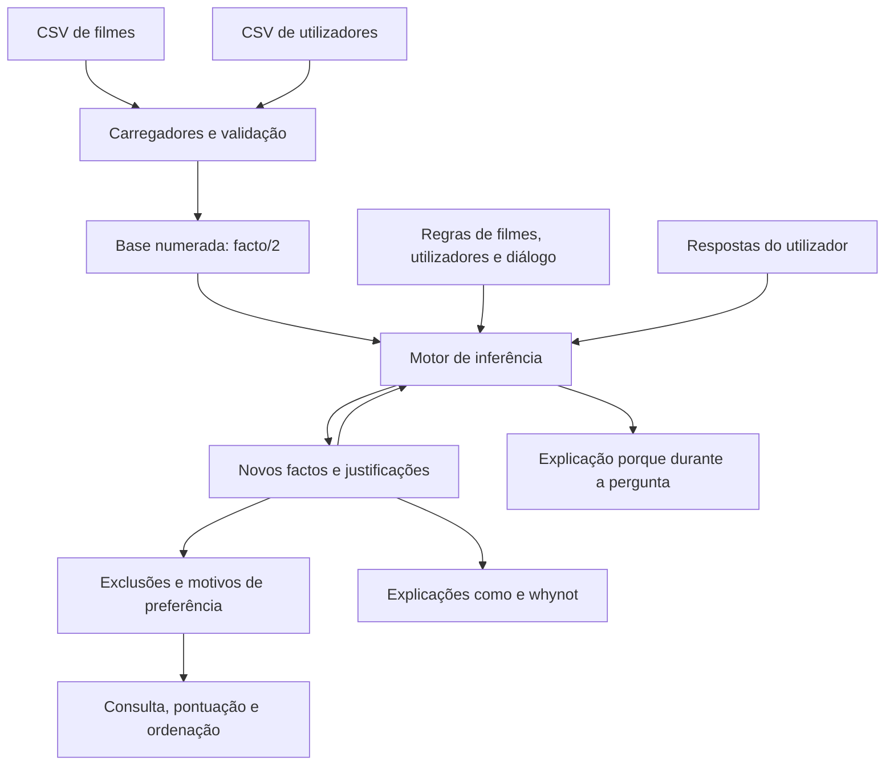
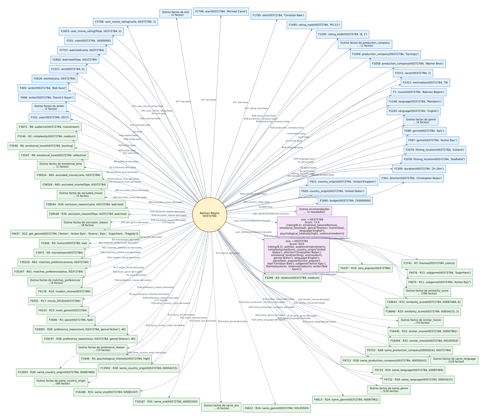
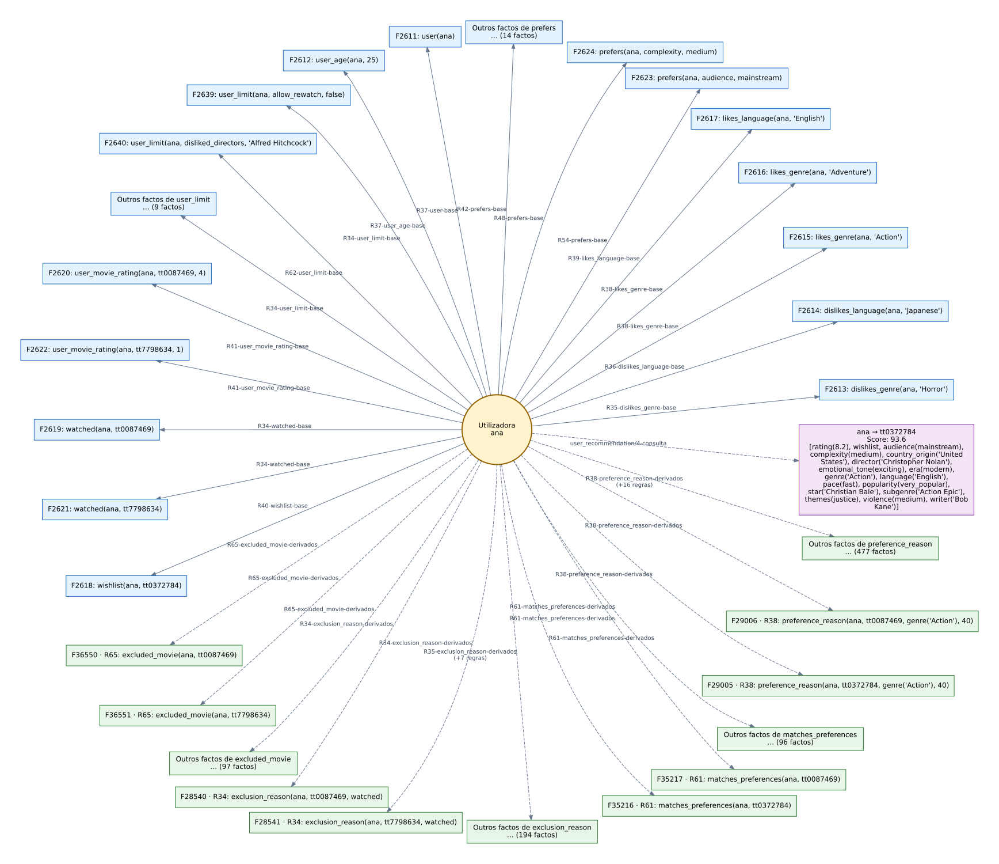
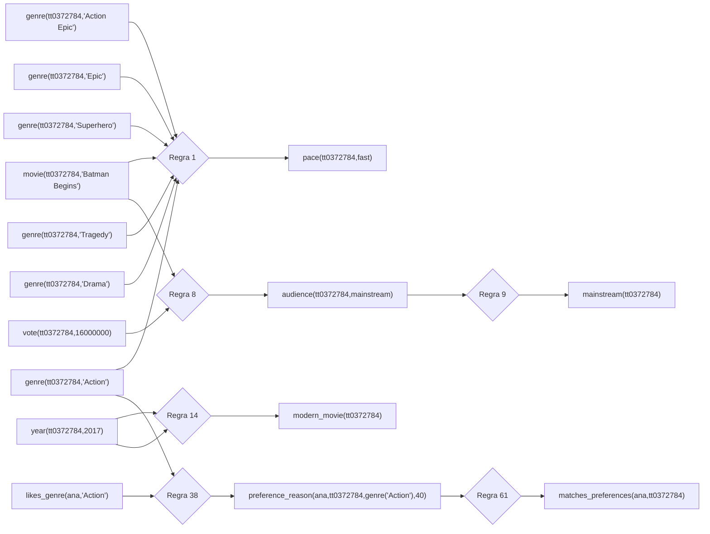
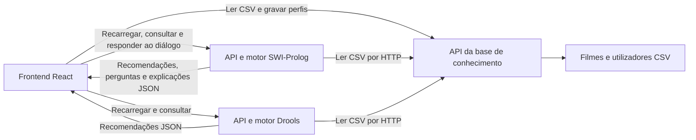

<!-- Numeração para impressão/PDF em motores com suporte a caixas de margem CSS.
     A capa conta como primeira página, mas não apresenta o rodapé. -->
<!-- <style>

@media print {
  @page {
    margin-bottom: 20mm;

    @bottom-center {
      content: "Página " counter(page) " de " counter(pages);
      font-family: Arial, sans-serif;
      font-size: 9pt;
      color: #666;
    }
  }

  @page :first {
    @bottom-center {
      content: none;
    }
  }
}
</style> -->

<div style=" box-sizing: border-box; display: flex; flex-direction: column; justify-content: space-between; gap: 12mm; padding: 8mm 0; text-align: center; break-after: page; page-break-after: always;">
  <div style="display: flex; flex-direction: row; flex-wrap: nowrap; align-items: center; justify-content: center; gap: 8%; width: 100%; margin: 0;">
    
    
  </div>
  <div>
    <h2 align="center" style="text-align: center; margin: 0 0 8mm;">Relatório Técnico</h2>
    <h1 align="center" style="text-align: center; margin: 0; line-height: 1.35;">Playgorithm — Sistema de Recomendação de Filmes</h1>
  </div>
  <p align="center" style="text-align: center; margin: 0; line-height: 2;">
    <strong>MEIA - PPROGIA - Paradigmas de Programação em Inteligência Artificial</strong><br />
    <strong>ISEP - 2026 / 2027</strong>
  </p>
  <div>
    <p align="center" style="text-align: center; margin: 0 0 6mm;"><strong>Equipa 5</strong></p>
    <p align="center" style="text-align: center; margin: 0; line-height: 1.8;">
      1181476 - Domingos Fonseca Pinto Rodrigues<br />
      1211199 - Eduardo Filipe Nolasco Carreiro<br />
      1260431 - Filipe Vályi Fontes<br />
      1211266 - Pedro Benjamim da Costa Allen<br />
      1260441 - Pedro Filipe Vale Gomes<br />
      1221173 - Simão Barreiros Lopes
    </p>
  </div>
  <br/>
  <br/>
  <p align="center" style="margin: 0;">
    
  </p>
</div>

## Índice

- [Introdução](#introdução)
- [Resumo e objetivos](#resumo-e-objetivos)
- [Enquadramento académico](#enquadramento-académico)
- [Aquisição de conhecimento com o perito](#aquisição-de-conhecimento-com-o-perito)
- [Respostas do perito sobre o projecto](#respostas-do-perito-sobre-o-projecto)
- [1. Organização e representação do conhecimento](#1-organização-e-representação-do-conhecimento)
- [2. Carregamento dos filmes e dos utilizadores](#2-carregamento-dos-filmes-e-dos-utilizadores)
- [3. Motor de inferência](#3-motor-de-inferência)
- [4. Mecanismos de explicação](#4-mecanismos-de-explicação)
- [5. Regras sobre filmes](#5-regras-sobre-filmes)
- [6. Regras sobre utilizadores e adequação do perfil](#6-regras-sobre-utilizadores-e-adequação-do-perfil)
- [7. Produção, pontuação e ordenação das recomendações](#7-produção-pontuação-e-ordenação-das-recomendações)
- [8. Regras de diálogo](#8-regras-de-diálogo)
- [9. Frontend: interface integrada de utilização](#9-frontend-interface-integrada-de-utilização)
- [10. API HTTP e arquitetura cliente-servidor](#10-api-http-e-arquitetura-cliente-servidor)
- [11. Verificação e limites da implementação](#11-verificação-e-limites-da-implementação)
- [12. Referências internas](#12-referências-internas)
- [13. Conclusão](#13-conclusão)

## Índice de figuras

- [Figura 1 — Fluxo de carregamento dos dados e de produção de recomendações e explicações.](#figura-1)
- [Figura 2 — Grafo da base de conhecimento de Batman Begins: atributos explícitos e conhecimento derivado.](#figura-2)
- [Figura 3 — Grafo da base de conhecimento de Ana: perfil declarado e consequências da sua combinação com os factos dos filmes.](#figura-3)
- [Figura 4 — Encadeamento de regras e factos de suporte para Batman Begins, incluindo a correspondência com as preferências de Ana.](#figura-4)
- [Figura 5 — Arquitetura cliente-servidor e fluxos de comunicação entre o frontend React, a base de conhecimento e os motores SWI-Prolog e Drools.](#figura-5)

<div style="break-after: page; page-break-after: always;"></div>

## Índice de tabelas

- [Tabela 1 — Sessões de aquisição e validação do conhecimento com o perito.](#tabela-1)
- [Tabela 2 — Resultados e apreciação dos cinco cenários avaliados pelo perito.](#tabela-2)
- [Tabela 3 — Ficheiros do sistema Prolog e respetivas responsabilidades.](#tabela-3)
- [Tabela 4 — Representação dos dados dos perfis de utilizador em predicados Prolog.](#tabela-4)
- [Tabela 5 — Condições das regras e operações de verificação do motor.](#tabela-5)
- [Tabela 6 — Comparação entre o motor prévio e os dois motores Prolog atuais.](#tabela-6)
- [Tabela 7 — Alterações no diagnóstico de conclusões não obtidas com whynot.](#tabela-7)
- [Tabela 8 — Estruturas de metaconhecimento e respetiva utilização.](#tabela-8)
- [Tabela 9 — Mecanismos de explicação: momento de utilização e informação apresentada.](#tabela-9)
- [Tabela 10 — Explicações disponíveis na interface web.](#tabela-10)
- [Tabela 11 — Grupos de regras sobre filmes e conhecimento produzido.](#tabela-11)
- [Tabela 12 — Pesos das características na pontuação de semelhança entre filmes.](#tabela-12)
- [Tabela 13 — Componentes da pontuação das recomendações personalizadas.](#tabela-13)
- [Tabela 14 — Decomposição da pontuação de Jungle Cruise para Inês.](#tabela-14)
- [Tabela 15 — Opções de experiência da sessão, perguntas e conclusões do diálogo.](#tabela-15)
- [Tabela 16 — Correspondência entre conclusões do diálogo e atributos do catálogo inferido.](#tabela-16)
- [Tabela 17 — Separadores da interface e respetivas funcionalidades.](#tabela-17)
- [Tabela 18 — Campos de pessoas e origens e respetivos efeitos no perfil.](#tabela-18)
- [Tabela 19 — Endpoints da API HTTP, parâmetros e resultados.](#tabela-19)
- [Tabela 20 — Campos de uma recomendação personalizada e significado para o cliente.](#tabela-20)
- [Tabela 21 — Resultados e alcance das verificações do núcleo e da API.](#tabela-21)
- [Tabela 22 — Ficheiros de testes Playwright e comportamentos verificados.](#tabela-22)

<div style="break-after: page; page-break-after: always;"></div>

## Introdução

Este relatório descreve o sistema Playgorithm: representação do conhecimento, carregamento de filmes e utilizadores, inferência, explicações e recomendação personalizada. A revisão de 23 de outubro de 2026 atualiza a integração com o frontend React, que permite gerir perfis, editar todas as categorias de preferências, consultar os dois motores e conduzir o diálogo com o motor Prolog inteiramente no navegador. A utilização destes fluxos não exige abrir a consola SWI-Prolog.

Os resultados quantitativos do núcleo, os grafos e o exemplo numérico conservam a data da verificação original, 21 de outubro de 2026. A revisão atual acrescenta a inspeção da implementação web e os resultados dos testes Playwright executados em Chromium contra os serviços locais reais. As duas verificações têm âmbitos distintos, identificados na secção 11.

## Resumo e objetivos

O projeto implementa um sistema de recomendação baseado em conhecimento: descreve filmes e utilizadores através de factos, aplica regras de produção para inferir características e adequação e ordena os candidatos elegíveis por uma pontuação explicável. O objetivo é apoiar a escolha de um filme considerando gostos, histórico, disponibilidade de tempo e composição etária da sessão. A recomendação resulta de políticas explícitas que podem ser inspecionadas e discutidas com o perito do domínio.

A solução integra uma interface React/TypeScript, um serviço de base de conhecimento e dois serviços de recomendação, SWI-Prolog e Drools, com APIs HTTP. A interface lê o catálogo e os perfis, persiste alterações e solicita o recarregamento dos motores. Permite consultar os resultados de um ou de ambos, com título, géneros, avaliação IMDb, pontuação e identificação de alternativas. As recomendações incluem explicações expansíveis dos motivos, das componentes da pontuação e das preferências não cumpridas. O separador Diálogo apresenta perguntas, justificação das perguntas, conclusões explicadas e sugestões de filmes para a sessão.

A metodologia deste relatório combina inspeção do código, execução de testes existentes e exemplos reproduzíveis. Os pesos e as heurísticas são políticas do protótipo; não se apresentam como resultados de aprendizagem automática ou de validação experimental com espectadores. A comparação do motor usa agora a versão prévia [sp_exp2.pl](../../../sp_exp2.pl), disponibilizada pelo professor, e as versões atuais [swi-prolog/sp_exp1.pl](../../../swi-prolog/sp_exp1.pl) e [swi-prolog/sp_exp2.pl](../../../swi-prolog/sp_exp2.pl). A análise distingue capacidades herdadas, alterações de controlo e extensões, apoiando-se também em duas experiências controladas. O [sp_exp1.pl da raiz](../../../sp_exp1.pl) foi consultado como referência complementar, sem substituir a versão prévia indicada como base de comparação.
<div style="break-after: page; page-break-after: always;"></div>

## Enquadramento académico

O Playgorithm é um **produto académico**, desenvolvido para demonstrar e avaliar a aquisição e representação de conhecimento, a inferência por regras e a explicação de recomendações. **Não é apresentado como um MVP (produto mínimo viável)** destinado a validar uma oferta comercial junto de utilizadores reais. A interface e a integração entre serviços permitem experimentar o sistema e avaliar as decisões dos motores no âmbito do trabalho. A sua utilização como serviço exigiria desenvolvimento adicional, nomeadamente na qualidade e abrangência dos dados, na segurança dos perfis e na robustez operacional, conforme discutido na secção 11.3.

## Aquisição de conhecimento com o perito

A apresentação que fizemos em **ENGCIA** identifica **João Mota** como perito do domínio, apresentado como ML/Ops Tech Lead na ARRISE e autor habitual de críticas de filmes. O seu contributo consiste no conhecimento heurístico necessário para interpretar os atributos dos filmes e avaliar a sua adequação ao utilizador. O conjunto de dados IMDb fornece o conhecimento factual sobre o qual essas heurísticas são aplicadas.

A aquisição inicial organiza-se em duas sessões, conforme registado na apresentação:

<p id="tabela-1" class="table-caption" align="center"><em>Tabela 1 — Sessões de aquisição e validação do conhecimento com o perito.</em></p>

| Sessão | Data | Objetivo e trabalho registado |
| --- | --- | --- |
| **Inquérito** | 30/09 | Identificar os critérios relevantes: atributos dos filmes e características, preferências e limitações dos utilizadores. |
| **Validação** | 01/10 | Apresentar e validar os fluxogramas do raciocínio do perito, incorporando pequenas correções. |

O princípio resultante distingue **restrições obrigatórias**, que excluem candidatos, de **preferências**, que valorizam e ordenam os filmes elegíveis. A apresentação exemplifica a passagem do conhecimento à regra com a correspondência entre um género preferido e o género do filme, materializada na regra 38 através de `preference_reason(U, M, genre(G), 40)`. Este exemplo ilustra a formalização no sistema; não constitui, por si só, uma transcrição das respostas do perito nem uma validação individual de todos os pesos implementados.

O processo é iterativo: os critérios adquiridos são formalizados em regras, implementados e confrontados com os resultados para posterior refinamento com o perito. O frontend atual permite apoiar essa análise através da edição dos perfis, da comparação entre motores e da consulta das explicações. A apresentação documenta as sessões iniciais; não comprova uma validação posterior de toda a versão atual.

<div style="break-after: page; page-break-after: always;"></div>

## Respostas do perito sobre o projecto

O questionário reúne apreciações do perito, João Mota efectuadas em 23/10/2026, sobre a utilização do protótipo, a representação do conhecimento adquirido, as explicações e os resultados de cinco cenários de teste, comparando os motores SWI-Prolog e Drools (disponível em Avaliacao_Perito_Playgorithm.pdf).

### Apreciação geral e representação do conhecimento

A apreciação global registada é de **4 em 5**. A facilidade de utilização, a clareza da introdução de preferências e restrições, a adequação das recomendações e a confiança nas sugestões receberam igualmente **4 em 5 — Concordo**. A resposta destaca a organização das preferências, a facilidade de comparação dos motores e a utilidade de consultar o peso de cada critério na explicação.

Quanto à representação do conhecimento, o documento assinala concordância (**4 em 5**) com a correspondência ao processo de decisão descrito na entrevista, o respeito pelas restrições obrigatórias, a exclusão de géneros, realizadores e atores rejeitados, a hierarquia género → classificação → realizador e atores e a apresentação de alternativas. Esta apreciação apoia a distinção entre condições que eliminam candidatos e preferências que contribuem para a sua ordenação, sem constituir uma validação isolada de todos os pesos e regras.

A exclusão de filmes com classificação etária ou linguagem inadequadas recebeu **3 em 5 — Não concordo nem discordo**. A resposta salienta que a adequação infantil depende da qualidade da classificação etária e da informação sobre o conteúdo. Assim, o comportamento observado do filtro do catálogo não permite concluir que toda a adequação a crianças esteja assegurada.

### Resultados dos cenários avaliados

O documento regista concordância com os resultados dos cinco cenários e coincidência entre os dois motores nos testes apresentados.

<div style="break-after: page; page-break-after: always;"></div>

<p id="tabela-2" class="table-caption" align="center"><em>Tabela 2 — Resultados e apreciação dos cinco cenários avaliados pelo perito.</em></p>

| Cenário | Resultado registado | Apreciação |
| --- | --- | --- |
| **A — Terror para um adulto**, nota mínima obrigatória de 8, duração até 120 minutos e inglês obrigatório. | *Psycho* foi o único resultado, com **65,5 pontos** em ambos os motores: 40 pelo género e 25,5 pela classificação. O catálogo indicava 109 minutos e nota 8,5. | Concordância com a recomendação e com o cumprimento dos limites. |
| **B — Sessão com uma criança de 8 anos**, preferência por animação/família, rejeição de terror e inglês obrigatório. | Foram obtidos **6 resultados por motor**, com *Footrot Flats: The Dog’s Tale* e *Hotel Transylvania 2* nos primeiros lugares. Todos tinham classificação G ou PG no catálogo e nenhum tinha o género Horror. | Concordância com o filtro observado, ressalvando a necessidade de verificação complementar do conteúdo. |
| **C — Ação para um adulto**, preferência por Christopher Nolan e Christian Bale, inglês obrigatório, até 140 minutos, nota mínima de 8 e rejeição de terror. | *Batman Begins* foi o único resultado, com **84,6 pontos**: 40 pelo género, 24,6 pela classificação, 10 pelo realizador e 10 pelo ator. | Concordância com a combinação de preferências e o cumprimento das restrições. |
| **D — Exclusão pelo histórico**, repetindo o cenário C após marcar *Batman Begins* como visto, sem permitir rever. | O número de resultados passou de **1 para 0** nos dois motores. | Concordância com a exclusão do filme visto e a manutenção dos restantes limites. |
| **E — Mínimo flexível e obrigatório**, inglês obrigatório, até 150 minutos, rejeição de Nolan e nota pretendida de 8 com tolerância de 0,5. | *Psycho* surgiu como recomendação principal e *Indiana Jones and the Temple of Doom*, com nota 7,5, como alternativa. Ao tornar o mínimo obrigatório, permaneceu apenas *Psycho*. | Concordância com a tolerância aplicada e com a exclusão da alternativa quando a condição passou a obrigatória. |

Estes cenários foram adaptados ao catálogo para demonstrar funcionalidades concretas. Os resultados sustentam a consistência dos comportamentos observados, mas não representam uma avaliação exaustiva do catálogo ou de todas as combinações de preferências.

### Explicações, falhas e melhorias propostas

Os três itens relativos à explicação receberam **4 em 5**: justificação da recomendação, identificação dos critérios com maior contribuição e indicação das preferências não cumpridas nas alternativas. A decomposição da pontuação de *Batman Begins* e a justificação da alternativa com nota 7,5 foram consideradas compreensíveis. Como melhoria, foi sugerida uma frase curta que sintetize os motivos da escolha e a utilização consistente de termos em português.

Não foram identificadas recomendações incorretas nos cenários descritos. Contudo, foram assinalados problemas nos dados do catálogo: *Psycho* aparece com o ano **2016** e *Batman Begins* com **2017**. Esses anos não foram usados como critérios de sucesso nos testes apresentados, pelo que a consistência das recomendações entre motores não elimina a necessidade de corrigir os dados de origem.

As prioridades indicadas são rever a qualidade dos dados, aumentar a variedade de filmes, acrescentar informação de conteúdo para sessões com crianças e simplificar os termos técnicos das explicações. Para uma versão futura, foram propostas a indicação das plataformas onde os filmes estão disponíveis, a possibilidade de guardar condições apenas para uma sessão — por exemplo, dispor de 90 minutos nesse dia —, o apoio à descoberta de sagas e a utilização de avaliações de pessoas com gostos semelhantes.

A resposta considera o sistema adequado como **apoio à escolha de filmes**, destacando a combinação de preferências, a exclusão de títulos já vistos e a possibilidade de compreender a decisão. Para uma utilização mais alargada, identifica como condições relevantes a atualização do catálogo e a confirmação do conteúdo em sessões com crianças. Estas observações orientam o refinamento da base de conhecimento e da apresentação das recomendações.

## 1. Organização e representação do conhecimento

O sistema combina regras de produção com predicados auxiliares Prolog. As regras transformam dados do catálogo e dos perfis em características, relações de semelhança, motivos de preferência e motivos de exclusão. As consultas finais agregam esse conhecimento para obter recomendações.

<p id="tabela-3" class="table-caption" align="center"><em>Tabela 3 — Ficheiros do sistema Prolog e respetivas responsabilidades.</em></p>

| Ficheiro | Responsabilidade |
| --- | --- |
| [filmes_bc.pl](../../../swi-prolog/filmes_bc.pl) | Carregar os componentes e construir a base de factos numerados. |
| [movies_loader.pl](../../../swi-prolog/movies_loader.pl) | Converter o CSV de filmes em predicados de dados. |
| [user_bc.pl](../../../swi-prolog/user_bc.pl) | Interpretar e validar os perfis do CSV de utilizadores. |
| [sp_exp1.pl](../../../swi-prolog/sp_exp1.pl) | Motor de produção básico, com registo de justificações. |
| [sp_exp2.pl](../../../swi-prolog/sp_exp2.pl) | Motor com negação por ausência, explicações e perguntas interativas. |
| [rules_movies.pl](../../../swi-prolog/rules_movies.pl) | Caracterização dos filmes e cálculo de semelhanças. |
| [rules_users.pl](../../../swi-prolog/rules_users.pl) | Preferências, exclusões e consulta de recomendações. |
| [rules_user.pl](../../../swi-prolog/rules_user.pl) | Compatibilidade com carregamentos antigos; importa `rules_users.pl`. |
| [user_constraints.pl](../../../swi-prolog/user_constraints.pl) | Conversões, limites, pontuação, ordenação e explicação da adequação. |
| [rules_dialog.pl](../../../swi-prolog/rules_dialog.pl) | Perguntas e regras de diálogo por utilizador. |

A memória de trabalho usa `facto(N, F)`, em que `N` identifica o facto e `F` representa o conhecimento. Por exemplo, `facto(42, genre(filme_exemplo, 'Drama'))` associa um número a uma característica. Este exemplo é ilustrativo: os números dependem do carregamento e da ordem das inferências.

O contador `ultimo_facto/1` permite atribuir novos identificadores. Para factos inferidos, `justifica(N, ID, Evidencias)` liga a conclusão à regra aplicada e aos factos que a sustentaram. Os dados de entrada não recebem essa justificação de regra.



<p id="figura-1" align="center"><em>Figura 1 — Fluxo de carregamento dos dados e de produção de recomendações e explicações.</em></p>

<div style="break-after: page; page-break-after: always;"></div>

## 2. Carregamento dos filmes e dos utilizadores

### 2.1. Filmes

`load_movies/0`, em `movies_loader.pl`, lê a origem definida em `MOVIES_CSV` (URL HTTP ou caminho local), usando por omissão `../knowledge_base/movies.csv`, relativo ao diretório Prolog. Cada linha contém 19 campos: identificador, título, votos, ano, duração, classificação etária, avaliação IMDb, orçamento, realizadores, argumentistas, atores, géneros, países, locais de filmagem, produtoras, idiomas, vitórias, nomeações e Óscares.

Os campos com múltiplos valores são separados por vírgulas dentro da célula CSV. O carregador normaliza espaços e cria um facto por elemento, como `genre(Id, G)`, `star(Id, S)` e `language(Id, L)`. Os campos simples originam predicados como `movie/2`, `year/2`, `duration/2` e `rating_imdb/2`.

O carregamento substitui os predicados de dados existentes. A validação é menos extensa do que a dos utilizadores: o cabeçalho é ignorado e a estrutura depende da ordem dos 19 campos. Quando chamado isoladamente, `load_movies/0` remove os dados anteriores antes da leitura e não constitui uma substituição atómica em caso de erro. O recarregamento da API é diferente: `recarrega_base/1` envolve a leitura, a reconstrução e a inferência numa transação, preservando o estado anterior se a operação falhar.

### 2.2. Utilizadores

`load_users/0` lê `../knowledge_base/users.csv`, relativo ao diretório Prolog, ou a origem definida na variável de ambiente `USERS_CSV` (URL HTTP ou caminho local). As oito primeiras colunas são fixas: identificador, idade, histórico, lista de desejos, géneros preferidos e rejeitados, idiomas preferidos e rejeitados. As restantes colunas têm de corresponder a preferências ou limites reconhecidos.

As listas usam `|` como separador. Um campo vazio não acrescenta uma preferência. A normalização inclui a conversão de `Sci-Fi` para `SciFi`, compatibilizando esse valor com o catálogo.

<p id="tabela-4" class="table-caption" align="center"><em>Tabela 4 — Representação dos dados dos perfis de utilizador em predicados Prolog.</em></p>

| Informação | Representação produzida |
| --- | --- |
| Identidade e idade | `user(U)`, `user_age(U, Idade)` |
| Géneros e idiomas preferidos | `likes_genre(U, G)`, `likes_language(U, L)` |
| Rejeições | `dislikes_genre(U, G)`, `dislikes_language(U, L)` |
| Lista de desejos | `wishlist(U, Filme)` |
| Histórico | `watched(U, Filme)`, `user_movie_rating(U, Filme, Nota)` |
| Preferências adicionais | `prefers(U, Atributo, Valor)` |
| Restrições | `user_limit(U, Criterio, Valor)` |

No histórico, uma entrada como `tt0087469=4` representa um filme visto com avaliação pessoal 4. As avaliações são inteiras entre 1 e 5; 0 significa visto sem avaliação. Um identificador sem nota também recebe 0. O carregador rejeita filmes repetidos no histórico de uma pessoa.

São validados, entre outros aspetos, identificadores de utilizador únicos, idade entre 0 e 120, valores enumerados, intervalos numéricos e coerência entre os anos mínimo e máximo. Uma tolerância de avaliação exige a definição de uma avaliação mínima. Os termos do CSV são convertidos em estruturas previstas pelo programa; não são executados como código Prolog.

Os factos são primeiro preparados e validados e só depois substituem `user_fact/1`, numa transação. A atomicidade desta substituição não abrange todo o carregamento conjunto de filmes e utilizadores.

### 2.3. Construção da memória de trabalho

`filmes_bc.pl` carrega os ficheiros de regras e executa `carrega_factos_filmes/0` na inicialização. Este predicado carrega os dois CSV, seleciona os predicados de dados dos filmes, junta-lhes os termos de `user_fact/1` e numera o conjunto em `facto/2`.

A seleção explícita dos predicados de filmes evita importar regras ou consultas auxiliares como se fossem dados. O motor trabalha sobre esta memória numerada; definir apenas um predicado Prolog fora de `facto/2` não o transforma automaticamente numa condição reconhecida pelo motor.

No uso direto da consola, o carregamento limpa factos e justificações anteriores, mas não limpa `resposta_utilizador/2`; um reinício manual deve também remover essas respostas. O fluxo HTTP do diálogo tem outro ciclo de vida: reconstitui a interação dentro de `snapshot/1` a partir das respostas enviadas pelo frontend, sem conservar as alterações desse pedido na base global.

### 2.4. Base de conhecimento

Os dois grafos seguintes ilustram a memória de trabalho em torno de um filme e de uma utilizadora, relacionando os dados carregados com o conhecimento obtido após a execução do motor de inferência. O nó circular identifica a entidade analisada; os retângulos representam factos ou grupos de factos associados. As setas partem da entidade central para os respetivos factos, cuja ordem de argumentos preserva o significado da relação Prolog.

As cores dos grafos distinguem três tipos de informação:

- **Azul:** factos da base.
- **Verde:** factos derivados.
- **Violeta:** resultados calculados em consulta.

O identificador `F` corresponde à numeração em `facto/2` na extração. Nas ligações aos factos base, um rótulo como `R34-watched-base` identifica uma regra que usa esse predicado como condição, não uma regra que criou o dado. Nos derivados, `R4-humor-derivados`, por exemplo, identifica a regra que produziu a conclusão. A indicação de uma regra num facto base não significa, por si só, que todas as condições dessa regra tenham sido satisfeitas.

Para manter a leitura, apresentam-se até dois exemplos concretos por tipo de relação; os restantes são agrupados num nó genérico com a respetiva quantidade. A indicação `(+N regras)` abrevia regras adicionais. As contagens abaixo referem-se aos factos da extração, não ao número de retângulos visíveis. Os grafos foram atualizados a partir do catálogo e dos 11 perfis do CSV local, após a execução do motor em 21 de outubro de 2026. Representam essa execução; alterações posteriores dos dados exigem nova geração.

<div style="break-after: page; page-break-after: always;"></div>

#### Filme — Batman Begins

O grafo de **Batman Begins (`tt0372784`)** abrange **795 factos associados: 37 carregados e 758 derivados**. Inclui atributos do catálogo, como géneros, realizador, idiomas e duração, bem como classificações inferidas, relações de semelhança com outros filmes e relações com utilizadores. Por exemplo, `humor(tt0372784, low)` é uma conclusão da regra R4, obtida pelas heurísticas de género. Os valores apresentados reproduzem a base de conhecimento, sem correção por fontes cinematográficas externas.



<p id="figura-2" align="center"><em>Figura 2 — Grafo da base de conhecimento de Batman Begins: atributos explícitos e conhecimento derivado.</em></p>

[Abrir o SVG para ampliar](assets/graphs/filme.svg).

<div style="break-after: page; page-break-after: always;"></div>

#### Utilizadora — ana

O grafo de **ana** abrange **911 factos associados: 39 carregados e 872 derivados**. Os factos base descrevem a idade, as preferências, as rejeições, os limites, o histórico e a lista de desejos. As regras cruzam estes dados com o catálogo para produzir motivos de preferência, motivos de exclusão e as conclusões `matches_preferences/2` e `excluded_movie/2`. Um filme pode satisfazer preferências e, simultaneamente, ser excluído por uma restrição; a existência de motivos positivos não anula uma exclusão.



<p id="figura-3" align="center"><em>Figura 3 — Grafo da base de conhecimento de Ana: perfil declarado e consequências da sua combinação com os factos dos filmes.</em></p>

[Abrir o SVG para ampliar](assets/graphs/utilizador.svg).

Os nós violetas distinguem as recomendações dos factos materializados: `user_recommendation/4` calcula a pontuação e reúne os motivos em consulta, após a inferência e a verificação das exclusões. Assim, os grafos permitem observar a passagem dos dados de entrada para as conclusões do motor e, por fim, para os resultados apresentados ao utilizador.

<div style="break-after: page; page-break-after: always;"></div>

### 2.5. Como se encadeiam as regras

Exemplo concreto das dependências registadas pelo motor para o filme escolhido. As arestas dos factos de suporte para a regra representam uma conjunção; os testes e cálculos estão definidos no código da regra. A justificação registada é a primeira que criou o facto, não todas as provas alternativas possíveis.



<p id="figura-4" align="center"><em>Figura 4 — Encadeamento de regras e factos de suporte para Batman Begins, incluindo a correspondência com as preferências de Ana.</em></p>

## 3. Motor de inferência

### 3.1. Encadeamento para a frente

O motor usa encadeamento para a frente: parte dos factos disponíveis, procura regras cujas condições sejam satisfeitas e acrescenta as respetivas conclusões. A linguagem de regras é definida através de operadores Prolog:

```prolog
regra 38
    se [likes_genre(U, G)
        e genre(M, G)]
    entao [cria_facto(preference_reason(U, M, genre(G), 40))].
```

`arranca_motor/0` percorre as regras e as combinações de variáveis admitidas pelas suas condições. Depois de uma passagem, compara o contador de factos com o valor inicial. Se foram acrescentados factos, inicia outra passagem; termina quando uma passagem não acrescenta conhecimento.

`cria_facto/3` evita inserir novamente uma conclusão já existente. Para uma conclusão nova, atribui um identificador e regista a justificação. A repetição permite que uma regra use resultados obtidos por outras, mesmo quando estes só ficam disponíveis numa passagem posterior.

O motor percorre as regras pela ordem de carregamento e repete a avaliação até não surgirem novos factos. Não mantém uma lista de regras prontas a executar ordenada por prioridades, nem utiliza uma rede Rete para reutilizar resultados das verificações anteriores. A execução depende da enumeração das regras e condições em Prolog. A terminação pressupõe um conjunto finito de conclusões possíveis: a comparação do contador, por si só, não impede regras que gerem indefinidamente novos termos.

### 3.2. Verificação das condições

<p id="tabela-5" class="table-caption" align="center"><em>Tabela 5 — Condições das regras e operações de verificação do motor.</em></p>

| Condição | Operação |
| --- | --- |
| `P` | Procurar `facto(N, P)` e guardar `N` como evidência. |
| `X e Y` | Verificar da esquerda para a direita, propagando as variáveis. |
| `avalia(P)` | Recuperar um valor de um facto e aplicar uma comparação. |
| `teste(Goal)` | Executar um auxiliar Prolog, concebido para não alterar a base. |
| `recolhe(T, P, Valores)` | Reunir valores e identificadores dos factos correspondentes. |
| `nao P` | No segundo motor, verificar a ausência de prova de `P`. |
| `escolha(Chave, Valor)` | No segundo motor, recuperar ou pedir uma opção válida, preencher `Valor` e conservar o facto escolhido como evidência. |

Por exemplo, `avalia(year(M, >=, 2020))` consulta o ano e verifica o limite. `recolhe/3` permite calcular uma característica a partir de todos os géneros de um filme e conservar esses factos nas evidências.

A ordem das condições é relevante: testes aritméticos e negações devem surgir depois das condições que preenchem as suas variáveis. `teste/1` não regista uma evidência própria; quando um cálculo depende de dados que devem aparecer na explicação, as regras recolhem-nos previamente.

A negação é por ausência no momento da avaliação. O motor acrescenta factos, mas não retira automaticamente conclusões quando os dados que as sustentavam mudam. Por isso, alterações ao perfil ou ao catálogo exigem reconstruir a memória e voltar a executar o motor. Não se deve interpretar esta execução como um ponto fixo independente da ordem para regras arbitrárias com negação.
<div style="break-after: page; page-break-after: always;"></div>

### 3.3. Comparação com o motor de inferência prévio

#### 3.3.1. Versões analisadas e capacidades herdadas

A referência anterior é [../sp_exp2.pl](../../../sp_exp2.pl), na raiz do repositório. O comentário inicial associa esse motor à base de veículos; [../veiculos2.txt](../../../veiculos2.txt) contém exemplos do índice de disparo. As duas versões usadas no recomendador estão em [sp_exp1.pl](../../../swi-prolog/sp_exp1.pl) e [sp_exp2.pl](../../../swi-prolog/sp_exp2.pl), dentro de `swi-prolog`. Ter o mesmo nome não significa que os ficheiros tenham o mesmo comportamento.

As três versões interpretam regras de produção representadas por termos Prolog, usando unificação e pesquisa de soluções do próprio Prolog. A aplicação define a memória numerada, as ações e a proveniência. Mantêm-se a linguagem `regra ... se ... entao ...`, `facto/2`, `ultimo_facto/1`, `cria_facto/3`, `justifica/3`, as comparações de `avalia/2` e a prevenção de conclusões duplicadas.

**Negação, `como/1`, `whynot/1` e o registo de justificações já existiam no `sp_exp2.pl` prévio.** Não são apresentados como mecanismos inteiramente novos. O trabalho atual altera o controlo da inferência, amplia as condições admitidas e acrescenta aquisição interativa com explicação contextual, mantendo e adaptando mecanismos anteriores.

<p id="tabela-6" class="table-caption" align="center"><em>Tabela 6 — Comparação entre o motor prévio e os dois motores Prolog atuais.</em></p>

| Aspeto | `sp_exp2.pl` prévio, na raiz | `swi-prolog/sp_exp1.pl` | `swi-prolog/sp_exp2.pl` |
| --- | --- | --- | --- |
| Seleção de regras | Facto corrente e índice `facto_dispara_regras/2`. | Percurso de todas as regras. | Percurso de todas as regras. |
| Controlo de conclusão do ciclo | Comparação do identificador percorrido com `ultimo_facto/1`. | Passagens até não surgirem factos novos. | Passagens até não surgirem factos novos. |
| Combinações das condições | Corte após uma aplicação bem-sucedida por facto/regra. | Enumeração através de `forall/2`. | Enumeração através de `forall/2`. |
| `avalia/1` nas condições | Sim. | Sim. | Sim. |
| `teste/1` e `recolhe/3` | Não. | Sim. | Sim. |
| Negação por ausência | Sim. | Não. | Sim. |
| Registo `justifica/3` e prevenção de duplicados | Sim. | Sim. | Sim. |
| `como/1` | Sim. | Não. | Sim; mecanismo essencial preservado. |
| `whynot/1` | Sim. | Não. | Sim; diagnóstico adaptado. |
| Pausa após cada facto inferido | `get0(_)`. | Substituída por `nl`. | Substituída por `nl`. |
| Perguntas, respostas memorizadas e contexto | Não. | Não. | `perguntavel`, `resposta_utilizador` e `contexto`. |
| Explicação `porque` durante uma pergunta | Não. | Não. | Sim. |
| Escolha entre opções declaradas | Não. | Não. | `escolha/2`, `opcoes_pergunta/2` e `le_escolha/4`. |

O `sp_exp1.pl` atual é uma alternativa mais simples, não um sucessor que reúna todas as capacidades do `sp_exp2.pl` prévio: não inclui negação nem as consultas de explicação. Ambos os motores atuais partilham o novo ciclo e os auxiliares de condições. A API carrega explicitamente o segundo; `filmes_bc.pl` carrega o primeiro apenas quando ainda não existe `arranca_motor/0`. Por isso, para usar explicações e diálogo na consola, deve carregar-se `sp_exp2.pl` antes da base. As versões devem ser executadas em processos separados: definem predicados com os mesmos nomes e não constituem módulos intercambiáveis carregáveis em simultâneo.

#### 3.3.2. Controlo anterior: factos e índice manual de disparo

O núcleo anterior é:

```prolog
arranca_motor :-
    facto(N, Facto),
    facto_dispara_regras1(Facto, LRegras),
    dispara_regras(N, Facto, LRegras),
    ultimo_facto(N).
```

`facto_dispara_regras1/2` consulta o índice e compromete-se com a primeira entrada correspondente; se não encontrar uma entrada, devolve a lista vazia. Para cada identificador selecionado, `dispara_regras/3` verifica se o facto ocorre numa condição, instancia a regra, verifica as restantes condições e exige `member(N, LFactos)`. Este último teste confirma que o facto que desencadeia a avaliação participa nas evidências. Depois de concluir as ações, um corte impede explorar outras soluções dessa aplicação antes de avançar na lista de regras.

Na base de veículos, por exemplo, `facto_dispara_regras(peso(_, _), [6, 7])` declara quais as regras potencialmente relevantes para um facto de peso. Este índice constitui **metaconhecimento de controlo já presente na versão anterior**. Pode reduzir o número de regras verificadas, mas exige manutenção coordenada com a base: uma regra omitida das entradas relevantes pode nunca ser considerada. A primeira entrada correspondente deve reunir as regras necessárias, pois as entradas seguintes não são agregadas.

Há ainda uma limitação concreta no SWI-Prolog: uma chamada em curso a um predicado dinâmico segue a visão lógica das cláusulas existente quando essa chamada começou. Os novos factos inseridos por `assertz/1` não passam automaticamente a fazer parte da enumeração já iniciada por `facto(N, Facto)`. Se a inferência aumenta `ultimo_facto/1`, o identificador final pode deixar de coincidir com qualquer facto visível nessa enumeração. A chamada a `arranca_motor/0` pode então falhar apesar de ter inserido conclusões, e uma cadeia pode precisar de novas chamadas. Os efeitos de `assertz/1` não são desfeitos por essa falha. A experiência da secção 3.3.6 confirma este comportamento nas condições testadas.
<div style="break-after: page; page-break-after: always;"></div>

#### 3.3.3. Controlo atual: passagens até à saturação

As duas versões atuais substituem a seleção por facto e índice por um ciclo explícito. No `sp_exp1.pl`:

```prolog
arranca_motor :-
    ultimo_facto(Before),
    forall((regra ID se LHS entao RHS,
            verifica_condicoes(LHS, Evidence)),
           concluir(RHS, ID, Evidence)),
    ultimo_facto(After),
    ( After =:= Before -> true ; arranca_motor ).
```

No `sp_exp2.pl`, o gerador usa `verifica_condicoes/3`, acrescentando `contexto(ID, LHS, RHS)` para o diálogo. A decisão de repetir é a mesma. Cada passagem inicia novas consultas às condições, pelo que conclusões anteriores podem alimentar inferências posteriores. A regra deixa de necessitar de um facto desencadeador numerado e de uma entrada em `facto_dispara_regras/2`.

`forall/2` percorre as soluções produzidas pelo gerador e executa as ações para cada uma. As conclusões persistem pelos efeitos de `assertz/1`; não se está a usar `forall/2` para devolver as instanciações das variáveis ao chamador. Os cortes que selecionam o tipo de condição não eliminam, por si só, as alternativas produzidas pelas consultas de factos que vêm depois. Continuam, contudo, a existir escolhas comprometidas em auxiliares do domínio: a enumeração não transforma heurísticas com prioridades numa pesquisa de todas as interpretações possíveis.

O ganho é uma condição de paragem explícita e a cobertura de múltiplas instanciações das regras. O custo é reavaliar regras e combinações já verificadas; desaparece a filtragem proporcionada pelo índice manual. Não há evidência para afirmar que o novo ciclo é sempre mais rápido. Para N filmes, a comparação de pares introduz crescimento quadrático; o cruzamento com U utilizadores acrescenta trabalho dependente de U × N. O tempo total depende também das regras, passagens e resultados intermédios.

A saturação é operacional: termina quando não se acrescentam factos. Exige um conjunto finito de conclusões possíveis e não resolve automaticamente os problemas da negação por ausência. Não existe retração de conclusões nem garantia de um resultado independente da ordem para regras arbitrárias com negação. Uma agenda baseada em dependências poderia recuperar seletividade sem exigir o índice manual anterior, mas não está implementada.

#### 3.3.4. Condições, agregação e utilização pela API

O verificador foi decomposto: `verifica_condicoes` trata a conjunção e combina evidências; `verifica_condicao` trata cada espécie de premissa. Esta organização permite acrescentar:

- `teste(Goal)`: executa um auxiliar Prolog por `call/1`, para comparação, pertença ou cálculo. A utilização é concebida para testes puros, mas o motor não impõe essa pureza; as regras são código de confiança do projeto. Não gera evidências próprias.
- `recolhe(Template, Pattern, Values)`: reúne valores e identificadores de todos os factos correspondentes. Permite agregar géneros ou outras características conservando a sua proveniência.
- No segundo motor, a variante com contexto permite adquirir factos perguntáveis, apenas depois de as suas variáveis estarem preenchidas.
- `escolha(Chave, Valor)`: exige uma chave completamente instanciada, mas permite que o valor seja preenchido pela resposta. Reutiliza `facto(N, escolha(Chave, Guardado))` quando existe; caso contrário, consulta `opcoes_pergunta/2`, lê uma opção válida e regista-a na memória numerada. O identificador `N` integra as evidências da conclusão.

A avaliação numérica e a negação já existiam no motor anterior. Na versão atual do segundo motor, a evidência de uma comparação negada conserva o invólucro completo `nao avalia(X)`; anteriormente era guardada como `nao X`. Esta alteração melhora a identificação do tipo de condição na informação de proveniência.

A substituição de `get0(_)` por `nl` elimina a leitura de um carácter após cada conclusão. No motor anterior, essa leitura pode bloquear à espera de entrada quando existe uma consola interativa; a sua remoção permite calcular a base sem confirmações por facto. O segundo motor atual continua a poder ler respostas nas perguntas declaradas. Na execução normal da API, não se seleciona um `utilizador_atual/1` para iniciar o diálogo e a saída da inferência é redirecionada para um fluxo nulo.

A separação entre inferência e consulta final também é relevante no recomendador: `matches_preferences/2` não é uma decisão final de recomendação. Uma exclusão pode surgir posteriormente; `user_recommendation/4` aplica as exclusões após executar o motor e só então calcula os resultados. Esta política pertence à integração com o domínio, não é um novo operador do motor.

#### 3.3.5. Explicações e aquisição de conhecimento: preservação e alterações

O mecanismo essencial de `como/1` é herdado: procura a regra e as evidências em `justifica/3` e percorre recursivamente os factos antecedentes. A conservação de apenas uma justificação por conclusão também é herdada. O uso de `recolhe/3` permite agora alimentar esse mecanismo com as evidências de uma agregação.

No `whynot/1`, existem alterações concretas:

<p id="tabela-7" class="table-caption" align="center"><em>Tabela 7 — Alterações no diagnóstico de conclusões não obtidas com whynot.</em></p>

| Alteração | Comportamento anterior | Comportamento atual e limite |
| --- | --- | --- |
| Lista de regras explicativas vazia | A cláusula geral podia ter sucesso com `whynot1([])`, sem mensagem na primeira resposta. | Exige `LLPF \= []` antes de apresentar regras, permitindo chegar à mensagem de facto não definido quando não há diagnóstico aplicável. |
| Premissa falhada | Continuava a percorrer as restantes condições e podia reunir várias falhas no percurso escolhido. | Para na primeira falha, evitando avaliar cálculos posteriores com variáveis ainda não preenchidas. Apresenta menos falhas por percurso. |
| `teste(Goal)` | Não tinha tratamento próprio. | Apresenta diretamente o teste que falhou. |

A alteração do diagnóstico é um compromisso entre segurança de avaliação e quantidade de informação. Nenhuma das versões enumera necessariamente todas as combinações de premissas; ambas usam escolhas comprometidas. A versão atual também não acrescenta deteção de ciclos à explicação recursiva.

A aquisição interativa é uma extensão ausente no motor prévio: `perguntavel/1` controla o que pode ser perguntado, `texto_pergunta/2` fornece a frase, `resposta_utilizador/2` evita repetições e `contexto/3` fundamenta a resposta `porque.`. Os verificadores usados para diagnosticar factos mantêm-se separados da interação, evitando que um `whynot` faça novas perguntas. Este conjunto acrescenta metaconhecimento de aquisição e contexto ao metaconhecimento de proveniência já existente.

#### 3.3.6. Verificação experimental da comparação

Testámos o motor antigo e os atuais com os mesmos dados. Num teste, verificámos se uma conclusão permitia chegar à conclusão seguinte. Noutro, verificámos se eram encontradas todas as combinações. Com um único arranque, os motores atuais completaram ambos os testes; o antigo deixou resultados por obter.

<!-- Foram executadas duas bases mínimas em processos SWI-Prolog separados, carregando alternadamente o motor prévio e cada motor atual. A cada processo foi feita **uma única chamada** a `arranca_motor/0`; no fim foram recolhidos todos os factos, mesmo quando a chamada falhou. Foram fornecidos caracteres de mudança de linha na entrada para satisfazer as leituras `get0(_)` anteriores, sem modificar os motores. O ficheiro anterior foi carregado com `encoding(iso_latin_1)` e os atuais como UTF-8.

**Caso A — cadeia com duas regras.** A base usada foi:

```prolog
:- dynamic facto/2, ultimo_facto/1.
facto(1, p(a)).
ultimo_facto(1).
facto_dispara_regras(p(_), [1]).
facto_dispara_regras(q(_), [2]).
regra 1 se [p(X)] entao [cria_facto(q(X))].
regra 2 se [q(X)] entao [cria_facto(r(X))].
```

**Caso B — todas as combinações entre duas listas.** Noutro processo, usou-se:

```prolog
:- dynamic facto/2, ultimo_facto/1.
facto(1, p(a)).
facto(2, p(b)).
facto(3, q(x)).
facto(4, q(y)).
ultimo_facto(4).
facto_dispara_regras(p(_), [1]).
facto_dispara_regras(q(_), [1]).
regra 1 se [p(X) e q(Y)] entao [cria_facto(pair(X, Y))].
```

Os índices são usados apenas pelo motor prévio, mas foram mantidos nas mesmas bases para as três execuções. Depois de carregar o motor e a base correspondente, a observação equivale a:

```prolog
(arranca_motor -> Estado = sucesso ; Estado = falha),
findall(F, facto(_, F), Factos),
writeln(Estado-Factos).
```

<p id="tabela-8" class="table-caption" align="center"><em>Tabela 8 — Resultados das experiências de encadeamento e combinação de condições.</em></p>

| Experiência | Motor prévio da raiz | `swi-prolog/sp_exp1.pl` | `swi-prolog/sp_exp2.pl` |
| --- | --- | --- | --- |
| A: cadeia `p → q → r` | Insere `q(a)`, não insere `r(a)`; chamada falha. | Insere `q(a)` e `r(a)`; sucesso. | Insere `q(a)` e `r(a)`; sucesso. |
| B: produto de dois conjuntos | Insere `(a,x)`, `(b,x)` e `(a,y)`; falta `(b,y)`; chamada falha. | Insere as quatro combinações; sucesso. | Insere as quatro combinações; sucesso. |

No caso B, a seleção da primeira solução por facto desencadeador não assegura o produto completo; diferentes factos podem voltar a produzir uma combinação já conhecida. No ciclo atual, a enumeração das soluções das condições produz as quatro combinações.

Os resultados sustentam duas melhorias específicas: encadeamento completo neste exemplo com uma chamada e enumeração completa deste produto. Não constituem uma prova geral de completude, um ensaio de desempenho ou uma validação de regras arbitrárias com negação. Também não significam que o motor anterior nunca possa obter as conclusões em chamadas posteriores. -->

#### 3.3.7. Contributo a apresentar na avaliação

Para o critério «Alterações ao MI ou novo MI», a caracterização sustentada pelo código é **adaptação e extensão do motor fornecido**. Os contributos demonstráveis são a substituição do controlo por factos/indexação manual por passagens até à saturação, a enumeração de soluções, as novas condições `teste` e `recolhe`, a execução sem pausa por conclusão, a revisão do diagnóstico e o diálogo contextual com escolha entre opções declaradas. A base de filmes, os pesos e as regras de exclusão demonstram a aplicação do motor, mas devem ser apresentados separadamente das alterações ao seu funcionamento.
<div style="break-after: page; page-break-after: always;"></div>

### 3.4. Metaconhecimento: representação e utilização

O motor prévio já usava metaconhecimento de controlo em `facto_dispara_regras/2` e de proveniência em `justifica/3`. A implementação atual prescinde do índice manual, preserva a proveniência e acrescenta declarações e contexto para aquisição interativa. Assim, a evolução modifica a utilização do metaconhecimento; não o introduz pela primeira vez.

Metaconhecimento é informação sobre o próprio conhecimento e o seu processo de utilização. Deve distinguir-se dos factos do domínio: `genre(M, G)` descreve um filme; `justifica(N, Regra, Evidencias)` descreve como o sistema obteve uma conclusão.

<p id="tabela-8" class="table-caption" align="center"><em>Tabela 8 — Estruturas de metaconhecimento e respetiva utilização.</em></p>

| Estrutura | Conhecimento representado | Utilização efetiva |
| --- | --- | --- |
| `regra ID se LHS entao RHS` | Identidade, condições e ações de uma regra | Interpretar regras e procurar produtoras de uma conclusão no `whynot`. |
| `justifica/3` | Proveniência de um facto inferido | Reconstruir a cadeia de explicação com `como`. |
| `perguntavel/1` | Que tipos de factos podem ser pedidos ao utilizador | Controlar a aquisição interativa de respostas sim/não. |
| `opcoes_pergunta/2` | Valores admissíveis para uma chave de escolha | Apresentar as sete experiências e validar a opção recebida. |
| `texto_pergunta/2` | Forma de comunicar uma necessidade de informação | Apresentar perguntas específicas do domínio. |
| `contexto(ID, LHS, RHS)` | Regra que originou a pergunta atual | Explicar a finalidade através de `porque`. |
| `resposta_utilizador/2` | Perguntas binárias já respondidas e respetiva resposta | Evitar repetir perguntas durante a sessão. |

Exemplo: `perguntavel(aceita_final_triste(_))` declara uma política de aquisição, não uma preferência de uma pessoa concreta. Quando a regra `dialogo_3` necessita de `aceita_final_triste(ana)`, o motor verifica que o termo está completamente instanciado, consulta as respostas anteriores e pode perguntar. Se a pessoa escrever `porque.`, o contexto permite apresentar a regra em avaliação e a conclusão pretendida.

A pesquisa do `whynot` inspeciona os consequentes das regras para descobrir quais poderiam produzir um facto. Trata-se de raciocínio sobre a representação das regras, embora o diagnóstico tenha as limitações descritas na secção 4. Não existe um sistema de metarregras que aprenda novas regras, atribua prioridades dinamicamente ou resolva conflitos por confiança. Os pesos de preferências e as prioridades das heurísticas são políticas de domínio; não devem ser apresentados, por si só, como um mecanismo geral de controlo do motor.
<div style="break-after: page; page-break-after: always;"></div>

## 4. Mecanismos de explicação

<p id="tabela-9" class="table-caption" align="center"><em>Tabela 9 — Mecanismos de explicação: momento de utilização e informação apresentada.</em></p>

| Mecanismo | Momento e entrada | Informação apresentada |
| --- | --- | --- |
| `como(N)` | Após a inferência; número de facto | Regra e cadeia de evidências da conclusão. |
| `porque.` | Durante uma pergunta do motor | Regra em avaliação e finalidade da informação pedida. |
| `whynot(F)` | Após a inferência; termo de facto | Condições que impedem regras de produzir a conclusão. |

### 4.1. «Como?»

`como/1` consulta `justifica/3`, apresenta a regra aplicada e os factos usados e percorre recursivamente as evidências numéricas. Um facto sem justificação é apresentado como conhecido inicialmente.

```prolog
facto(N, pace(tt0372784, fast)), como(N).
```

A explicação recupera a derivação guardada. Não enumera todas as provas possíveis: se outra regra chega ao mesmo facto, a prevenção de duplicados conserva apenas a primeira justificação. Os testes puros também não aparecem como passos autónomos.

As escolhas válidas e as respostas afirmativas do diálogo são factos de entrada sem `justifica/3`. Consequentemente, `como/1` apresenta-as como conhecidas inicialmente, sem distinguir nessa mensagem a origem no CSV da origem numa resposta interativa.

### 4.2. «Porquê?»

O segundo motor transporta `contexto(ID, LHS, RHS)` durante a avaliação. Quando encontra uma condição declarada em `perguntavel/1`, totalmente instanciada e ainda desconhecida, pode pedir uma resposta.

`texto_pergunta/2` fornece uma frase natural. Na sua ausência, o motor apresenta o termo numa pergunta genérica. A leitura aceita `sim.`, `nao.` e `porque.`; outras entradas são rejeitadas e a pergunta é repetida.

`porque.` chama internamente `porque/2`: mostra a regra, as condições e as ações previstas, sem afirmar que a regra já foi satisfeita. Repete depois a pergunta. Não existe aqui uma consulta autónoma `porque/0` para introduzir no prompt normal.

Uma resposta afirmativa é guardada em `resposta_utilizador/2` e acrescenta um facto numerado. Uma resposta negativa fica guardada, mas não cria um facto de negação explícita. A memória das respostas evita perguntas repetidas nas passagens seguintes.
<div style="break-after: page; page-break-after: always;"></div>

### 4.3. «Porque não?»

`whynot/1` procura regras cujo consequente possa produzir o facto pedido. Para cada regra candidata, verifica as condições e identifica a primeira que falha no percurso examinado. Para premissas comuns, tenta explicar recursivamente a sua ausência; para testes e comparações, apresenta a falha diretamente.

```prolog
whynot(preference_reason(ines, tt0870154, pace(slow), 2)).
```

Este diagnóstico usa a base atual e não faz novas perguntas. Se o facto já existe, informa que não é falso. Quando não encontra uma explicação de regra aplicável, pode apresentar a mensagem de que o facto não está definido.

A análise não é uma enumeração completa de todas as combinações possíveis de premissas: a implementação usa escolhas comprometidas na verificação. Também não possui deteção explícita de ciclos na explicação recursiva. Deve ser usada após a execução do motor e, preferencialmente, com o facto pretendido completamente especificado. Para saber por que um filme foi excluído, é mais direto explicar o seu `exclusion_reason/3` existente através de `como/1`.

### 4.4. Explicações acessíveis no navegador

Os mecanismos do núcleo sustentam agora duas apresentações complementares:

<p id="tabela-10" class="table-caption" align="center"><em>Tabela 10 — Explicações disponíveis na interface web.</em></p>

| Local na interface | Ação | Informação apresentada |
| --- | --- | --- |
| Diálogo, em cada pergunta | **Porquê esta pergunta?** | Conclusões pretendidas, condições já conhecidas e condições ainda por verificar; a regra pode ser aberta com os seus termos Prolog. |
| Diálogo, em «O que concluí» | **como?** | Identificador da regra e premissas imediatas que sustentam a conclusão. |
| Diálogo, em «Excluído» | Responder **Não** | Conclusões que a regra da pergunta deixaria produzir e a resposta negativa que impediu esse percurso. |
| Recomendações, em cada filme | **Explicar [título]** | Motivos da recomendação, decomposição da pontuação e preferências não cumpridas, quando presentes na resposta do motor. |

Abrir uma explicação não responde à pergunta nem avança o diálogo. A apresentação «Excluído» explica o efeito das respostas negativas no percurso da sessão; não é um formulário de execução de `whynot/1` sobre qualquer facto ou filme. Da mesma forma, o botão «como?» apresenta a regra e as premissas da conclusão, sem reproduzir uma árvore recursiva genérica de `como/1`. A interface cobre a explicação do fluxo de utilização, mantendo as consultas Prolog da secção anterior como instrumentos técnicos de inspeção.
<div style="break-after: page; page-break-after: always;"></div>

## 5. Regras sobre filmes

As regras 1 a 33 enriquecem o catálogo antes da personalização.

<p id="tabela-11" class="table-caption" align="center"><em>Tabela 11 — Grupos de regras sobre filmes e conhecimento produzido.</em></p>

| Regras | Conhecimento produzido |
| --- | --- |
| 1–7 | Ritmo, complexidade, violência, humor, intensidade psicológica, tom e temas. |
| 8–10 | Público aproximado por votos: `mainstream` ou `niche`. |
| 11 | Subgéneros reconhecidos. |
| 12–18 | Época e década. |
| 19–21 | Popularidade por número de votos. |
| 22–23 | Lista de géneros e identificação de filmes com vários géneros. |
| 24–31 | Relações entre pares de filmes. |
| 32–33 | Semelhança qualitativa e pontuação de semelhança. |

As características de conteúdo são heurísticas baseadas nos géneros. Para níveis como ritmo ou complexidade, aplica-se a primeira correspondência da tabela de prioridades. Para temas e tom emocional, podem resultar várias etiquetas. Quando não há correspondência, usa-se `unknown`.

Os limites de época são fixos: anterior a 2000 é clássico, 2000–2019 é moderno e a partir de 2020 é recente. Não dependem do ano corrente. O limiar de público `mainstream` é 500 000 votos; a popularidade distingue ainda pelo menos um milhão de votos. `same_era/2`, apesar do nome, compara o mesmo ano exato.

A regra 32 considera dois filmes semelhantes quando partilham género e idioma. A regra 33 calcula uma pontuação separada:

<p id="tabela-12" class="table-caption" align="center"><em>Tabela 12 — Pesos das características na pontuação de semelhança entre filmes.</em></p>

| Característica em comum | Pontos |
| --- | --- |
| Género | 4 |
| Realizador | 3 |
| Argumentista | 2 |
| País de origem | 1 |
| Idioma | 1 |

Cada grupo contribui uma única vez, mesmo com múltiplos valores comuns. O máximo é 11. A pontuação é calculada para pares de filmes distintos, incluindo pares com valor zero. Atores e produtoras têm relações próprias, mas não entram nesta fórmula. A comparação entre todos os pares implica crescimento quadrático no número de filmes.
<div style="break-after: page; page-break-after: always;"></div>

## 6. Regras sobre utilizadores e adequação do perfil

A personalização combina preferências graduais com condições obrigatórias. As preferências acrescentam motivos positivos; as restrições podem impedir a recomendação, independentemente da pontuação.

As regras 38–60 produzem `preference_reason(U, M, Motivo, Peso)`. Consideram géneros, idiomas, lista de desejos, realizadores, argumentistas, atores, países, subgéneros, características inferidas, época e popularidade. A regra 61 conclui `matches_preferences/2` quando existe pelo menos um motivo positivo.

O histórico contribui através da regra 41: uma avaliação pessoal de pelo menos 4 e uma semelhança de pelo menos 7 com outro filme criam um motivo `liked_similarity/1`. Ter visto um filme não equivale a gostar dele. O método não aprende pesos nem compara perfis de pessoas semelhantes; usa regras explícitas e semelhança de conteúdo.

As regras 34–37 e 62–69 tratam exclusões e a sua consolidação:

- Filmes vistos, salvo autorização explícita para rever.
- Géneros, idiomas, realizadores ou atores rejeitados.
- Incompatibilidade com a idade considerada para a sessão.
- Duração superior ao máximo e ano fora dos limites pedidos.
- Ausência de qualquer idioma obrigatório compatível.
- Avaliação IMDb abaixo do limite efetivo.

Cada motivo origina `exclusion_reason/3`; a regra 65 transforma qualquer motivo em `excluded_movie/2`. Uma lista de desejos ou preferência forte não anula uma exclusão.

`session_min_age` substitui a idade do perfil para avaliar a sessão. A política implementada aceita qualquer filme para adultos e, para menores, usa a tabela interna G→0, PG→0, PG-13→13, R→18 e NC-17→18. É uma política do protótipo, não uma classificação legal. Para menores com idade conhecida, classificações ausentes ou desconhecidas não são aceites. Se não existir idade nem idade de sessão, `session_age/2` falha e a regra de exclusão etária não dispara; não se deve afirmar que a idade foi validada nesse caso.

Quando há um limite explícito de duração, ano ou avaliação, dados ausentes ou inválidos que não permitam demonstrar o seu cumprimento levam à exclusão. Nos idiomas obrigatórios, basta corresponder a um dos idiomas pedidos. Preferir um idioma, por outro lado, apenas acrescenta pontos.

A adequação ao utilizador resulta, assim, de representar o seu perfil, verificar a elegibilidade de cada filme e valorizar as correspondências. As alterações persistentes são feitas no CSV e requerem recarregamento. Os factos introduzidos na sessão não são automaticamente gravados no ficheiro.
<div style="break-after: page; page-break-after: always;"></div>

## 7. Produção, pontuação e ordenação das recomendações

`user_recommendation(U, M, Score, Reasons)` é uma consulta executada após `arranca_motor/0`. Enumera filmes de um utilizador conhecido, elimina os excluídos, reúne motivos distintos e calcula a pontuação. Não é uma regra que materialize um facto de recomendação.

A consulta não exige `matches_preferences/2`: um filme elegível pode ser recomendado mesmo sem motivos pessoais positivos, recebendo a componente da avaliação IMDb quando disponível.

A fórmula é:

```text
Score = Género + IMDb + Realizador + Ator + Secundários
```

<p id="tabela-13" class="table-caption" align="center"><em>Tabela 13 — Componentes da pontuação das recomendações personalizadas.</em></p>

| Componente | Contributo |
| --- | --- |
| Género | 40 se existir pelo menos um género preferido em comum. |
| IMDb | 3 × avaliação, até 30; zero sem avaliação válida. |
| Realizador | 10 se existir correspondência. |
| Ator | 10 se existir correspondência. |
| Secundários | Soma dos outros pesos, limitada a 9. |

O máximo é 99 pontos, não uma probabilidade nem uma percentagem. Vários géneros, atores ou realizadores não multiplicam os respetivos máximos. Nos motivos secundários, a semelhança com o histórico contribui no máximo 1 ponto, independentemente do número de referências apreciadas. A pontuação final é arredondada a duas casas decimais.

A avaliação mínima pode admitir tolerância: com objetivo 7 e tolerância 0,5, um filme com 6,6 pode permanecer elegível como `alternative`. Com `rating_required=true`, a tolerância efetiva é zero. Os restantes limites não são relaxados por este mecanismo.

`recommendation_key/4` ordena primeiro recomendações `main`, depois `alternative`; dentro de cada grupo, usa pontuação decrescente, avaliação IMDb decrescente e identificador. `user_recommendation/4` sozinho não ordena resultados. Uma consulta completa é:

```prolog
findall(Key-Movie-Title-Score-Reasons,
        (user_recommendation(ines, Movie, Score, Reasons),
         facto(_, movie(Movie, Title)),
         recommendation_key(ines, Movie, Score, Key)),
        Candidates),
sort(Candidates, Ranked).
```

`score_breakdown/3` apresenta as componentes da pontuação. `recommendation_explanation/5` apresenta o estatuto, requisitos cumpridos e preferências não satisfeitas. Estes predicados complementam a explicação das regras: `como/1` recebe números de factos e não explica diretamente uma consulta agregada.

### Exemplo verificado com os dados locais

Para Inês, usando o perfil do CSV local, e o filme `tt0870154` do catálogo local, identificado como *Jungle Cruise*, a execução de 21 de outubro confirmou:

<p id="tabela-14" class="table-caption" align="center"><em>Tabela 14 — Decomposição da pontuação de Jungle Cruise para Inês.</em></p>

| Componente | Pontos |
| --- | --- |
| Género | 40 |
| IMDb, avaliação 6,6 | 19,8 |
| Realizador | 10 |
| Ator | 10 |
| Secundários | 9 |
| **Total** | **88,8** |

O resultado é `alternative`, porque a avaliação 6,6 está abaixo do objetivo 7, mas dentro da tolerância 0,5. A explicação identificou também a preferência por intensidade psicológica média como não satisfeita. Isso não implica exclusão, porque é uma preferência gradual.

O cálculo usa os valores efetivamente armazenados no CSV. Não verifica metadados numa fonte externa. A pontuação elevada deste exemplo não demonstra que seja o primeiro da lista: o grupo `main` precede o grupo `alternative` na ordenação.
<div style="break-after: page; page-break-after: always;"></div>

## 8. Regras de diálogo

O diálogo de [rules_dialog.pl](../../../swi-prolog/rules_dialog.pl) contém **16 regras**: uma para selecionar a experiência, três para o percurso emocional e duas para cada um dos outros seis percursos. A escolha inicial é feita no segundo motor, através da condição `escolha/2`:

```prolog
regra dialogo_experiencia
    se [user(U)
        e utilizador_atual(U)
        e escolha(experiencia(U), Experiencia)]
    entao [cria_facto(experiencia_sessao(U, Experiencia))].
```

`opcoes_pergunta(experiencia(_), Opcoes)` declara sete opções. A seleção fica guardada como facto de entrada `escolha(experiencia(U), Opcao)`; a regra produz `experiencia_sessao(U, Opcao)` com justificação. No fluxo normal, apenas o percurso escolhido é ativado, evitando perguntar por todas as experiências.

<p id="tabela-15" class="table-caption" align="center"><em>Tabela 15 — Opções de experiência da sessão, perguntas e conclusões do diálogo.</em></p>

| Opção inicial | Perguntas de aprofundamento | Conclusões possíveis |
| --- | --- | --- |
| `emocao` | História emocional; situações da vida real; aceitação de um final triste | `perfil_sessao(U, emocional)` → `sugerir_genero(U, 'Drama')` → `sugerir_tom(U, triste)`, mediante respostas afirmativas sucessivas. |
| `comedia` | Preferência por humor numa história romântica | `Comedy`; acrescenta `Romantic Comedy` se a resposta for afirmativa. |
| `acao` | Interesse numa aventura | `Action`; acrescenta `Adventure` se a resposta for afirmativa. |
| `misterio` | Interesse em suspense e tensão | `Mystery`; acrescenta `Thriller` se a resposta for afirmativa. |
| `terror` | Preferência por elementos sobrenaturais | `Horror`; acrescenta `preferencia_sessao(U, sobrenatural)` se a resposta for afirmativa. |
| `ficcao_cientifica` | Interesse em sociedades dominadas pela tecnologia | `SciFi`; acrescenta `Cyberpunk` se a resposta for afirmativa. |
| `fantasia` | Interesse numa missão ou jornada | `Fantasy`; acrescenta `Quest` se a resposta for afirmativa. |

Nos seis percursos não emocionais, a escolha inicial define o género base, mantido mesmo após resposta negativa. No emocional, uma resposta negativa interrompe a cadeia dependente dessa condição.

### 8.1. Interação pelo frontend

O utilizador abre **Diálogo**, escolhe uma das sete experiências e responde através de botões. As opções aparecem em português, com ícones; as perguntas binárias oferecem **Sim** e **Não**. O histórico mantém as perguntas e respostas, e cada pergunta permite abrir a sua justificação. Não é necessário escrever termos Prolog nem executar comandos no terminal.

O hook `useDialogue` envia `POST /api/dialogo` com o identificador do utilizador e o conjunto de respostas. O controlador `dialogue_controller.pl` valida as chaves e os valores, executa apenas as regras cujo identificador começa por `dialogo` e suspende a execução na primeira pergunta ainda sem resposta. A resposta HTTP inclui o histórico, a próxima pergunta ou `null`, as conclusões com premissas e os filmes sugeridos.

Cada execução decorre dentro de `snapshot/1`: as alterações temporárias do diálogo são descartadas quando o pedido termina. O frontend conserva as respostas por utilizador no estado de `UserParameters`, permitindo mudar de separador ou de perfil e regressar à conversa. Não as grava no CSV nem em armazenamento persistente do navegador; recarregar a página inicia uma nova sessão de interação.

**Mudar esta resposta** conserva apenas as respostas anteriores à pergunta escolhida. A pergunta selecionada e as seguintes voltam a ser avaliadas, evitando conservar conclusões de um ramo abandonado. **Recomeçar** envia um conjunto vazio de respostas. Esta reconstrução por pedido permite rever a conversa sem introduzir retração automática no motor geral.

### 8.2. Sugestões de filmes para a sessão

As conclusões do diálogo são agora usadas por `session_picks/2`, que cruza as recomendações elegíveis do utilizador com as características pretendidas para a sessão:

<p id="tabela-16" class="table-caption" align="center"><em>Tabela 16 — Correspondência entre conclusões do diálogo e atributos do catálogo inferido.</em></p>

| Conclusão | Correspondência no catálogo inferido |
| --- | --- |
| `sugerir_genero(U, G)` | `genre(Filme, G)` |
| `sugerir_tom(U, triste)` | `emotional_tone(Filme, sad)` |
| `preferencia_sessao(U, sobrenatural)` | `themes(Filme, supernatural)` |

São admitidos filmes com pelo menos uma correspondência. A ordenação dá prioridade ao número de correspondências e, em seguida, à chave de ordenação das recomendações; são devolvidos até 12 filmes. A pontuação apresentada continua a ser a do perfil: o diálogo seleciona e reordena candidatos, sem somar novos pesos à fórmula de 99 pontos. Os limites e exclusões do perfil continuam a aplicar-se.

O painel **Sugestões de hoje** apresenta título, ano, avaliação IMDb, pontuação e etiquetas das correspondências. Distingue a ausência de conclusões, a ausência de filmes elegíveis que correspondam às conclusões e a existência de resultados. **O que concluí** apresenta os factos em linguagem legível e a opção «como?». **Excluído** associa as conclusões não obtidas às respostas negativas.
<div style="break-after: page; page-break-after: always;"></div>

### 8.3. Exemplo de demonstração

1. Selecionar ou criar um utilizador e abrir **Diálogo**.
2. Abrir **Porquê esta pergunta?** e consultar a regra `dialogo_experiencia`.
3. Escolher **Comédia**; o motor conclui a sugestão de comédia e pergunta pela preferência por romance com humor.
4. Abrir a justificação da pergunta para inspecionar `dialogo_comedia_2`.
5. Responder **Não** e observar a explicação em **Excluído**.
6. Usar **Mudar esta resposta**, responder **Sim** e abrir «como?» na conclusão `Romantic Comedy`.
7. Consultar os filmes que correspondem à sessão e usar **Recomeçar** para iniciar outro percurso.

O leitor de consola continua disponível para testes unitários e inspeção técnica. Nesse modo, `le_escolha/4` e os leitores binários aceitam opções declaradas e `porque.`, conservando escolhas e respostas na memória do processo. Estas particularidades do terminal não são requisitos de utilização do frontend.

## 9. Frontend: interface integrada de utilização

### 9.1. Tecnologias e identidade visual

A aplicação usa React, TypeScript e Vite, com componentes Material UI, estilos Emotion e notificações Sonner. `main.tsx` carrega a configuração dos serviços antes de montar o tema e o contexto partilhado. A interface está localizada em português de Portugal, incluindo os principais controlos e mensagens. Os identificadores do catálogo e os valores enviados aos motores mantêm o seu formato original; títulos de filmes, nomes de pessoas e algumas etiquetas técnicas não são traduzidos.

O visual atual aproxima-se da identidade Playgorithm: fundo verde muito escuro (`#061713`), painéis verde-escuros (`#0f1e1b`), realces verdes (`#2ac79a`), texto branco e texto secundário cinzento. `theme.ts` define tipografia de sistema, botões sem transformação para maiúsculas, cantos arredondados e contornos discretos. Os estados são comunicados por texto, ícones, seleção e cor.

O painel superior reúne os perfis em etiquetas com avatar, a identidade do utilizador selecionado e as ações de edição. A área principal organiza-se em cinco separadores:

<p id="tabela-17" class="table-caption" align="center"><em>Tabela 17 — Separadores da interface e respetivas funcionalidades.</em></p>

| Separador | Funcionalidade |
| --- | --- |
| **Preferências** | Géneros, idiomas, subgéneros, características, ambiente, temas e limites da recomendação. |
| **Filmes** | Histórico de filmes vistos, avaliação pessoal e lista de desejos. |
| **Pessoas e origens** | Realizadores, atores, argumentistas e países preferidos; realizadores e atores rejeitados. |
| **Recomendações** | Seleção de SWI-Prolog e/ou Drools, resultados e explicações por filme. |
| **Diálogo** | Perguntas de sessão, respostas, justificações, conclusões e sugestões contextualizadas. |

Por omissão, as recomendações surgem no respetivo separador. **Mostrar recomendações ao lado** desloca-as para um painel lateral e remove esse separador da navegação. Em ecrãs médios ou maiores, o painel ocupa três das doze colunas e a área de edição ocupa nove; sem painel lateral, a área principal usa a largura disponível. **Mostrar recomendações como separador** repõe a navegação e abre as recomendações. Em ecrãs pequenos, as áreas empilham-se. A grelha adaptável está implementada; os testes descritos adiante usam Chromium em configuração desktop.

### 9.2. Dados, perfis e persistência

`AppContext` concentra os utilizadores, o catálogo, o perfil selecionado, os motores ativos e o estado de recarregamento de cada motor. O arranque lê `GET /users.csv` e `GET /movies.csv` da base de conhecimento em paralelo. Os conversores tratam campos CSV entre aspas através de `csvFields`; o leitor de utilizadores continua a separar linhas antes de analisar os campos, não constituindo um leitor geral de células multilinha.

O painel permite criar, selecionar, editar e eliminar perfis, com as seguintes regras:

- **Nome:** não pode ficar vazio nem duplicar outro identificador.
- **Idade:** deve ser inteira entre 0 e 120; vazio/zero é tratado como idade não definida.
- **Eliminação:** exige confirmação e não permite remover o último perfil.

Selecionar um perfil não constitui autenticação.

`useUsers` envia criações, alterações e eliminações para a API da base de conhecimento, que persiste os dados no CSV. `userToRow` serializa listas com `|`, histórico como `id=nota` e valores opcionais como texto vazio. Após a escrita, o frontend relê os utilizadores e desencadeia o recarregamento dos dois motores, mesmo que não estejam selecionados para apresentação. Os recarregamentos são independentes e a gravação do perfil não espera pela sua conclusão.

Os formulários de **Preferências**, **Filmes** e **Pessoas e origens** mantêm rascunhos locais e disponibilizam três opções:

- **Guardar:** persiste as alterações.
- **Repor:** recupera o perfil do contexto.
- **Guardar automaticamente:** opção do menu de gravação que persiste as alterações cinco segundos após a última alteração válida. Mantém-se ao trocar de separador ou utilizador durante a sessão.

A barra apresenta alterações pendentes, contagem decrescente, erros e confirmação de gravação. A navegação pode descartar rascunhos não guardados, pois os formulários são desmontados; não existe confirmação de abandono.

### 9.3. Preferências, restrições e filmes

Os géneros e idiomas alternam entre gostar, rejeitar e estado neutro. Os subgéneros dispõem de seletores próprios. Ritmo, complexidade, violência, humor, intensidade psicológica, público, época, popularidade, tom emocional e temas admitem múltiplos valores. Os rótulos apresentados são traduzidos, preservando os valores técnicos usados no perfil.

Duração máxima, intervalo de lançamento e idade do espectador mais novo são campos numéricos opcionais. A avaliação IMDb mínima e a tolerância usam controlos deslizantes; **Mínimo estrito** desativa a tolerância e **Permitir rever** autoriza filmes já vistos. A interface valida intervalos, valores inteiros e coerência dos anos. Rejeitar idiomas ou subgéneros remove preferências incompatíveis nos campos relacionados.

A tolerância visual varia de 0 a 5, enquanto o carregador Prolog admite até 10. A validação da interface cobre os campos implementados, mas não torna a persistência e a aceitação pelos motores uma operação atómica: a base de conhecimento pode aceitar uma escrita que um motor venha a rejeitar ao recarregar.

Em **Filmes**, os seletores pesquisam títulos e apresentam o ano. O histórico permite adicionar, remover e avaliar filmes de 1 a 5; zero significa visto sem opinião. Filmes já presentes no histórico não reaparecem nas opções de adição. A lista de desejos permite várias escolhas e assinala filmes já vistos quando a política de rever está desativada. Avaliações 4 e 5 podem beneficiar filmes semelhantes; a aplicação destas regras pertence aos motores.

### 9.4. Pessoas e origens

O separador está implementado com seis seletores de múltiplos valores, alimentados pelos nomes existentes no catálogo:

<p id="tabela-18" class="table-caption" align="center"><em>Tabela 18 — Campos de pessoas e origens e respetivos efeitos no perfil.</em></p>

| Campo | Efeito no perfil |
| --- | --- |
| Realizadores de que gostas | Preferência por filmes desses realizadores. |
| Realizadores de que não gostas | Exclusão dos filmes desses realizadores. |
| Atores de que gostas | Preferência por filmes com esses atores. |
| Atores de que não gostas | Exclusão dos filmes com esses atores. |
| Argumentistas de que gostas | Motivo secundário de preferência. |
| Países de origem | Motivo secundário de preferência. |

Rejeitar um realizador ou ator remove-o automaticamente da lista de preferidos; as opções de preferência também excluem os nomes rejeitados. Valores já guardados continuam visíveis mesmo que deixem de constar do catálogo. A gravação conserva os restantes campos do perfil e desencadeia a atualização dos motores. Os testes verificam os seis campos após recarregar a página e a remoção de preferências incompatíveis.

### 9.5. Recomendações e explicações por filme

`EngineSelector` permite selecionar nenhum, um ou ambos os motores. Sem seleção, a interface pede que se escolha pelo menos um. Cada motor selecionado recebe `GET /api/recomendacoes_utilizador?user_id=…&limit=20`; a aplicação conserva a ordenação devolvida e não calcula a pontuação no navegador.

Cada resultado apresenta título, até três géneros, avaliação IMDb e pontuação, incluindo valores decimais. As alternativas recebem uma etiqueta. Com os dois motores selecionados, cada lista é identificada pelo nome do motor e apresentada lado a lado quando a largura permite. A ausência de resultados surge como **Sem filmes elegíveis.**; os erros de consulta e de recarregamento têm apresentação própria.

O botão de explicação de cada filme abre e fecha três grupos, quando os dados correspondentes existem:

- **Porque foi recomendado**: motivos de `reasons`.
- **Pontuação**: componentes efetivas de `score_breakdown`, após os limites de cada grupo.
- **Preferências não cumpridas**: entradas de `unmet_preferences`.

A resposta da API também pode incluir `satisfied_requirements`, mas este campo não tem um bloco próprio no componente atual. A descrição da interface distingue, assim, os dados devolvidos pelo servidor dos efetivamente apresentados.

`useRecommendations` suspende consultas enquanto o motor recarrega e volta a pedir resultados quando o recarregamento termina. Pedidos substituídos são cancelados com `AbortController`. Um erro num motor não impede a consulta do outro; se o recarregamento falhar, uma consulta posterior pode mostrar dados anteriores acompanhados de aviso. A interface não disponibiliza paginação além dos 20 resultados pedidos.

### 9.6. Diálogo e gestão da sessão

O separador **Diálogo** apresenta uma conversa com mensagens do motor e respostas do utilizador, acompanhada pelos painéis de sugestões e conclusões. **Porquê esta pergunta?**, **como?**, **Mudar esta resposta** e **Recomeçar** tornam acessíveis os mecanismos descritos nas secções 4 e 8.

A interação usa o motor Prolog, independentemente dos motores selecionados em **Recomendações**. Os dois espaços têm objetivos distintos: **Recomendações** compara listas calculadas a partir do perfil persistido; **Diálogo** restringe e reordena candidatos Prolog segundo as respostas da sessão. Estas respostas não alteram automaticamente as preferências guardadas.
<div style="break-after: page; page-break-after: always;"></div>

### 9.7. Configuração e execução

O Compose da raiz reúne frontend, base de conhecimento, SWI-Prolog e Drools:

```bash
# Na raiz do repositório.
docker compose up -d --build
```

A aplicação fica disponível em `http://localhost:4173`. `frontend/public/config.json` define os endereços usados pelo navegador: base de conhecimento em `8090`, Prolog em `8081` e Drools em `8082`. Em Docker, a configuração é montada como volume de leitura; numa instalação remota, os endereços devem ser acessíveis a partir da máquina do utilizador.

Para desenvolvimento local do frontend:

```bash
cd frontend
npm install
npm run dev
```

Vite usa normalmente a porta 5173. `npm run build` verifica TypeScript e gera a distribuição; `npm run preview` serve essa distribuição. A suite de integração está na raiz, com `npm run test:e2e`, e não no `package.json` do frontend. Os testes recentes usaram os serviços Docker já ativos; esta revisão não corresponde a uma reconstrução limpa das imagens nem a uma nova compilação do frontend.
<div style="break-after: page; page-break-after: always;"></div>

## 10. API HTTP e arquitetura cliente-servidor

### 10.1. Responsabilidades e fluxo

A API está implementada no módulo [server.pl](../../../swi-prolog/api/server.pl), usando as bibliotecas HTTP do SWI-Prolog. O arranque carrega os dados e executa a inferência antes de iniciar o servidor. Os pedidos seguintes consultam os factos já inferidos e calculam os resultados agregados. Não se volta a executar todo o motor por cada pedido HTTP.



<p id="figura-5" align="center"><em>Figura 5 — Arquitetura cliente-servidor e fluxos de comunicação entre o frontend React, a base de conhecimento e os motores SWI-Prolog e Drools.</em></p>

A divisão evita duplicar a política de recomendação no navegador: os motores determinam elegibilidade, pontuação e ordenação; a base de conhecimento persiste dados e o cliente recolhe preferências e apresenta resultados. A API Prolog está organizada em controllers de saúde, filmes, utilizadores, recarregamento e diálogo. O frontend envia também as respostas da sessão a `POST /api/dialogo`.

`start/1` protege o arranque com um mutex e regista a porta ativa. O servidor usa `thread_httpd` e memória inferida partilhada. Os endpoints de recarregamento permitem reconstruir o conhecimento sem reiniciar o processo; não existe uma transação distribuída que englobe a escrita do CSV e a atualização de ambos os motores.
<div style="break-after: page; page-break-after: always;"></div>

### 10.2. Contrato implementado

<p id="tabela-19" class="table-caption" align="center"><em>Tabela 19 — Endpoints da API HTTP, parâmetros e resultados.</em></p>

| Método e caminho | Parâmetros | Resultado |
| --- | --- | --- |
| `GET /api/health` | Sem parâmetros | Estado `ok`. |
| `POST /api/reload/users` | Sem parâmetros | Recarrega utilizadores e reconstrói inferências. |
| `POST /api/reload/movies` | Sem parâmetros | Recarrega filmes e reconstrói inferências. |
| `POST /api/reload` | Sem parâmetros | Recarrega filmes e utilizadores e reconstrói inferências. |
| `GET /api/filmes` | `genre`, `pace`, `complexity`, `limit=20`, `offset=0` | Catálogo filtrado e paginado. |
| `GET /api/filme` | `id` obrigatório | Um filme com atributos originais e inferidos. |
| `GET /api/recomendacoes` | `id` obrigatório, `min_score=0`, `limit=10` | Filmes semelhantes ao filme indicado, por pontuação de 0 a 11. |
| `GET /api/recomendacoes_utilizador` | `user_id` obrigatório, `limit=10`, `offset=0` | Recomendações pessoais com pontuação até 99 e explicações. |
| `POST /api/dialogo` | JSON com `user_id` e `answers` opcional | Histórico, pergunta pendente, conclusões justificadas e até 12 sugestões para a sessão. |

`limit` admite inteiros entre 1 e 100 e `offset` inteiros não negativos. `min_score` é inteiro entre 0 e 11. Os filtros do catálogo combinam-se por conjunção. A paginação é aplicada depois de determinar os candidatos; nas respostas paginadas, `total` indica o número antes do corte da página.

A recomendação por filme e a recomendação por utilizador têm significados distintos. A primeira mede semelhança de conteúdo e não recebe um perfil nem aplica as suas restrições. A segunda verifica o perfil e devolve os grupos `main` e `alternative`, com a ordenação descrita na secção 7. As suas pontuações não devem ser comparadas entre endpoints.
<div style="break-after: page; page-break-after: always;"></div>

Um item personalizado contém:

<p id="tabela-20" class="table-caption" align="center"><em>Tabela 20 — Campos de uma recomendação personalizada e significado para o cliente.</em></p>

| Campo | Significado para o cliente |
| --- | --- |
| `movie` | Identificador, título, atributos escalares e listas de atributos. |
| `score` | Pontuação final calculada pelo servidor. |
| `reasons` | Motivos positivos e avaliação usada. |
| `status` | Recomendação principal ou alternativa dentro da tolerância. |
| `satisfied_requirements` | Requisitos verificados como cumpridos. |
| `unmet_preferences` | Preferências não satisfeitas, sem implicar necessariamente exclusão. |
| `score_breakdown` | Contribuição efetiva de cada grupo após aplicação dos limites. |

A API serializa motivos e verificações em objetos estruturados, permitindo ao React gerar frases e etiquetas. O cliente deve apresentar `score_breakdown` em vez de somar os pesos brutos dos motivos. Os atributos multivalorados são listas e os escalares ausentes são `null`. Alguns números do CSV são preservados como texto, por exemplo uma avaliação com vírgula; a normalização usada no cálculo não converte automaticamente todos os campos expostos.

Os handlers devolvem erros em JSON com os seguintes códigos HTTP:

- **400:** parâmetros inválidos ou obrigatórios ausentes.
- **404:** filme ou utilizador inexistente.
- **405:** métodos não aceites.
- **500:** erros inesperados.

`OPTIONS` é suportado e CORS permite qualquer origem, sem credenciais. A API não aceita código Prolog fornecido pelo cliente.

A API Prolog não cria nem altera perfis: essas operações pertencem à base de conhecimento (`POST /users`, `PUT /users/{user_id}` e `DELETE /users/{user_id}`), e a listagem usada pelo frontend vem de `GET /users.csv`. `POST /api/dialogo` expõe a interação e as justificações estruturadas do diálogo; não é um endpoint para executar consultas Prolog arbitrárias nem para obter árvores genéricas de `como/1` ou diagnósticos de `whynot/1`. Um CSV semanticamente inválido pode originar 422 no recarregamento; a persistência anterior na base de conhecimento não é automaticamente revertida. As explicações agregadas já disponíveis por HTTP não equivalem à exposição integral do mecanismo de proveniência. Também não existe autenticação; um `user_id` é um identificador de consulta, não uma prova de identidade.
<div style="break-after: page; page-break-after: always;"></div>

O corpo de um pedido de diálogo tem, por exemplo, a seguinte forma; `ana` deve existir na base de conhecimento:

```json
{
  "user_id": "ana",
  "answers": {
    "experiencia": "comedia",
    "prefere_romance_com_humor": "sim"
  }
}
```

A resposta do diálogo contém quatro campos principais:

- `history`: histórico da interação.
- `question`: próxima pergunta, com `key`, `text`, `options` e `why`. O campo `why` identifica a regra, as condições, a condição em avaliação e as conclusões pretendidas. Quando não há mais perguntas, `question` é `null`.
- `conclusions`: conclusões, cada uma com `fact`, `rule` e `premises`.
- `picks`: filmes sugeridos para a sessão.

Chaves desconhecidas ou respostas fora das opções declaradas originam 400. O navegador reenvia as respostas da sessão em cada interação, não um comando de consola.

### 10.3. Execução reproduzível e distribuição

Para utilização normal, o arranque integrado e o acesso pelo navegador estão descritos na secção 9.7. Para inspeção técnica isolada da API, a partir da raiz:

```bash
cd swi-prolog
swipl -q -s api/server.pl -g 'server:start(8080), thread_get_message(stop)'
```

Noutra consola:

```bash
curl 'http://localhost:8080/api/health'
curl 'http://localhost:8080/api/filmes?pace=fast&limit=3'
curl 'http://localhost:8080/api/recomendacoes?id=tt0372784&min_score=7'
curl 'http://localhost:8080/api/recomendacoes_utilizador?user_id=ines&limit=5'
curl -i 'http://localhost:8080/api/filme?id=inexistente'
```

O Dockerfile Prolog inicia `server:start(8080)` e o Compose publica `8081:8080`; Drools usa `8082:8080`. A divergência de portas da revisão anterior já não existe na configuração atual. Os motores recebem `MOVIES_CSV` e `USERS_CSV` com URLs do serviço `knowledge-base:8090` e aguardam o seu healthcheck. O frontend usa os endereços externos definidos em `config.json`.
<div style="break-after: page; page-break-after: always;"></div>

### 10.4. Fluxo integrado e consistência

O fluxo implementado é: selecionar perfil → editar → guardar na base de conhecimento → pedir recarregamento dos motores e reler os perfis → consultar recomendações dos motores selecionados. A interface trata separadamente erros de escrita, de recarregamento e de consulta. A gravação na base de conhecimento não garante que todos os motores aceitem os dados: este serviço armazena texto e os motores validam o conteúdo ao recarregar.

O segundo fluxo integrado é: abrir Diálogo → enviar respostas → receber pergunta e conclusões → apresentar sugestões → rever uma resposta ou recomeçar. O servidor reconstrói a interação por pedido; o navegador mantém o estado transitório por utilizador. A persistência de pessoas e origens, as explicações de recomendações e os controlos de diálogo são exercitados pelos testes da secção 11. A manutenção de rascunhos em caso de falha de escrita e todos os modos de falha dos serviços não estão integralmente cobertos por essa suite.
<div style="break-after: page; page-break-after: always;"></div>

## 11. Verificação e limites da implementação

### 11.1. Verificação histórica do núcleo

Os resultados deste bloco pertencem à revisão de 21 de outubro de 2026 e não foram novamente executados nesta atualização documental. Nessa data, as quatro suites Prolog foram executadas com o segundo motor, carregando diretamente o CSV local de utilizadores, sem substituição por uma versão Git. A leitura e a execução terminaram sem erros e os 57 casos passaram. Existem 52 definições de teste: 48 de filmes, utilizadores e restrições e quatro de diálogo. O teste parametrizado `ramos` executa seis opções, pelo que o total corresponde a **57 casos executados**: os 48 anteriores e nove casos de diálogo.

```bash
# Na raiz do repositório; usa os CSV locais por omissão.
cd swi-prolog
swipl -q -s sp_exp2.pl \
  -g "consult(['tests_movies_engine.pl','tests_users.pl','tests_user_constraints.pl','tests_dialog.pl']),run_tests" \
  -t halt
```

Na mesma verificação, o teste de integração HTTP também terminou com sucesso, usando o ficheiro temporário de perfis criado pelo próprio teste:

```bash
cd swi-prolog
python3 api/test_http.py
```

Este teste inicia um servidor temporário com perfis próprios e verifica endpoints, filtros, paginação, recomendações, soma das componentes da pontuação, alternativas, mínimo estrito, restrições de sessão, erros, CORS e métodos HTTP. A abertura da porta local exigiu execução fora da sandbox; o resultado foi `OK: endpoints, filtros, paginação, recomendações, erros, CORS e métodos HTTP`.
<div style="break-after: page; page-break-after: always;"></div>

<p id="tabela-21" class="table-caption" align="center"><em>Tabela 21 — Resultados e alcance das verificações do núcleo e da API.</em></p>

| Verificação executada | Resultado | Alcance |
| --- | --- | --- |
| Testes Prolog de filmes, utilizadores e restrições | 48/48 aprovados | Casos funcionais e propriedades definidos nas três suites. |
| Testes Prolog de diálogo | 9/9 casos aprovados, em quatro definições | Seis percursos parametrizados, cadeia emocional, resposta negativa e explicação/opção inválida. |
| Teste HTTP com servidor temporário | Aprovado | Contrato e comportamento dos casos exercitados pelo script. |
| Contagem da base carregada | 100 filmes, 11 utilizadores, 85 regras | Recontagem em 21 de outubro, com o CSV local legível. |
| Exemplo de Inês / `tt0870154` | 88,8 pontos; `alternative` | Decomposição 40 + 19,8 + 10 + 10 + 9. |
| Frontend na revisão de 21 de outubro | Inspeção de código | Superada, para os fluxos descritos abaixo, pelos testes no navegador de 23 de outubro. |

Foram também reconfirmados o número de filmes, utilizadores locais e regras, a pontuação de 88,8 do exemplo e as contagens dos grafos (795 factos associados ao filme e 911 à utilizadora). A passagem destes testes não constitui uma avaliação da qualidade das recomendações por utilizadores reais nem comprova cobertura completa do diálogo.

[tests_dialog.pl](../../../swi-prolog/tests_dialog.pl) injeta respostas por um fluxo de texto, verifica a escolha de um único percurso, a reutilização sem novas perguntas, o efeito de uma resposta negativa, a proveniência da conclusão emocional e o contexto apresentado por `porque.`. O teste cobre também uma opção inicial inválida. Não verifica todas as combinações de respostas, fim de entrada, erros de sintaxe ou isolamento entre sessões concorrentes. As experiências de comparação com o motor prévio da secção 3.3.6 mantêm os resultados da revisão anterior; não foram repetidas nesta atualização.

### 11.2. Verificação do frontend

A suite Playwright contém **nove cenários**, executados com um único worker para evitar escritas e recarregamentos concorrentes entre testes. Usa os serviços reais e perfis temporários com identificadores únicos; não simula respostas dos motores. Nos cenários de diálogo, pessoas/origens e recomendações, a criação, interação e eliminação do perfil são feitas pela interface. A fixture observa os pedidos de recarregamento desencadeados pelo frontend e aguarda os dois motores na preparação e limpeza.
<div style="break-after: page; page-break-after: always;"></div>

<p id="tabela-22" class="table-caption" align="center"><em>Tabela 22 — Ficheiros de testes Playwright e comportamentos verificados.</em></p>

| Ficheiro | Casos | Comportamento verificado |
| --- | --- | --- |
| `tests/example.spec.ts` | 1 | Criação e edição de perfil, histórico, lista de desejos, persistência e apresentação da resposta Drools. Inclui inspeção HTTP e limpeza pela API. |
| `tests/porque.spec.ts` | 1 | Justificação da pergunta sem responder nem avançar a interação. |
| `tests/explanations.spec.ts` | 3 | Regra e premissas de uma conclusão; explicação de resposta negativa e revisão; conservação entre separadores e reinício do ramo. |
| `tests/people-and-origins.spec.ts` | 2 | Persistência dos seis campos após recarregar; remoção de realizadores e atores preferidos ao rejeitá-los. |
| `tests/recommendations.spec.ts` | 2 | Comparação de motores, explicações, pontuação decimal, mudança entre painel e separador e ausência de filmes elegíveis. |

A execução completa mais recente terminou com **oito casos aprovados e uma falha no teste**, que aceitava apenas pontuações inteiras apesar de o motor devolver corretamente `28.5 pts`. Após corrigir a expressão de verificação, os **dois testes de recomendações passaram** numa execução dirigida. Os nove cenários ficaram, assim, validados entre essas execuções; não se apresenta esse resultado como uma única execução final de nove aprovações. Foram também corrigidas a seleção dos painéis, que incluía a área de notificações, e a espera pela conclusão dos recarregamentos.

```bash
# Na raiz, com os serviços ativos e as dependências Playwright instaladas.
npm run test:e2e

# Repetir apenas os cenários de recomendações.
npx playwright test tests/recommendations.spec.ts --project=chromium
```

O alvo validado foi Chromium desktop. A configuração contém outros projetos de navegador, mas não há nesta revisão resultados de Firefox, WebKit, dispositivos móveis ou avaliação formal de acessibilidade. A suite não testa todas as combinações de respostas, todos os perfis, concorrência entre sessões nem indisponibilidade de cada serviço. A aprovação dos cenários demonstra o comportamento observado, não a qualidade das recomendações para espectadores reais.
<div style="break-after: page; page-break-after: always;"></div>

### 11.3. Limites e evolução

Os principais limites técnicos são:

- Ausência de retração automática de conclusões.
- Conservação de apenas uma justificação por facto.
- Análise parcial de alternativas no `whynot/1`.
- Custo da comparação entre todos os filmes.

As etiquetas inferidas a partir de géneros e os pesos de recomendação são escolhas explícitas do sistema, não resultados de aprendizagem estatística.

O perfil é ajustado através de dados declarados, histórico avaliado e contexto de sessão. Não existe neste núcleo aprendizagem automática contínua do utilizador nem persistência automática das respostas do diálogo. As preferências de sessão já filtram e reordenam sugestões; uma evolução possível é estudar o seu peso na pontuação, sem confundir esse trabalho com a integração web já existente. Permanecem oportunidades de melhorar a distinção entre dados desconhecidos e respostas negativas, ampliar a rastreabilidade e cobrir mais cenários de falha e concorrência.

A abrangência das recomendações depende também dos factos disponíveis nos CSV. O catálogo atual não representa a pertença de um filme a uma saga nem a ordem dos títulos nessa saga. Por isso, o sistema não considera explicitamente a continuidade narrativa, a necessidade de ver títulos anteriores ou a recomendação do próximo filme de uma sequência. Incorporar esse conhecimento exigiria enriquecer os dados de origem e definir factos e regras próprios, articulados com o histórico do utilizador.

Há ainda informação disponível que não é explorada pelas regras atuais de recomendação. Os campos de prémios conquistados, nomeações e Óscares (`win`, `nomination` e `oscar`) já existem no CSV e são carregados, mas não contribuem para a pontuação de preferência. Uma evolução possível seria permitir ao utilizador valorizar filmes premiados e explicar essa contribuição no resultado. A definição desses critérios e dos respetivos pesos deveria ser discutida com o perito, evitando assumir que o reconhecimento por prémios corresponde necessariamente ao gosto de cada pessoa.

Do lado dos utilizadores, uma evolução seria introduzir contas com autenticação (*login*) e controlo de acesso aos perfis, ao histórico e às preferências. A seleção de um perfil na interface atual não constitui autenticação. Para proteger os dados, o serviço teria de verificar a identidade e as permissões em cada operação de consulta ou alteração, associando cada perfil ao seu titular.

Esse modelo permitiria também a **partilha autorizada de perfis**: um utilizador poderia disponibilizar a outro os seus gostos, listas de filmes ou parte do histórico. A partilha deveria depender de uma autorização explícita do titular, com escolha dos dados e destinatários, distinção entre consulta e edição e possibilidade de revogar o acesso. Estas funcionalidades constituem possibilidades de evolução do produto académico e não capacidades já implementadas.
<div style="break-after: page; page-break-after: always;"></div>

## 12. Referências internas

A implementação do núcleo está nos ficheiros ligados na secção 1. A comparação histórica usa o [motor prévio](../../../sp_exp2.pl) e a [base de veículos](../../../veiculos2.txt). Os grafos e fontes editáveis encontram-se em [filme.svg](assets/graphs/filme.svg), [utilizador.svg](assets/graphs/utilizador.svg), [filme.dot](assets/graphs/filme.dot) e [utilizador.dot](assets/graphs/utilizador.dot).

A integração web foi conferida em:

- [App.tsx](../../../frontend/src/App.tsx), [theme.ts](../../../frontend/src/lib/theme.ts) e [UserParameters.tsx](../../../frontend/src/components/parameters/UserParameters.tsx): estrutura, identidade visual e navegação.
- [PeopleAndOrigins.tsx](../../../frontend/src/components/parameters/PeopleAndOrigins.tsx): seis campos e tratamento de preferências incompatíveis.
- [Recommendations.tsx](../../../frontend/src/components/recommendations/Recommendations.tsx), [EngineRecommendations.tsx](../../../frontend/src/components/recommendations/EngineRecommendations.tsx) e [RecommendationExplanation.tsx](../../../frontend/src/components/recommendations/RecommendationExplanation.tsx): motores, resultados e explicações.
- [Dialogue.tsx](../../../frontend/src/components/dialogue/Dialogue.tsx), [WhyExplanation.tsx](../../../frontend/src/components/dialogue/WhyExplanation.tsx), [DialogueResults.tsx](../../../frontend/src/components/dialogue/DialogueResults.tsx) e [useDialogue.ts](../../../frontend/src/hooks/useDialogue.ts): interação, justificações e estado da sessão.
- [dialogue_controller.pl](../../../swi-prolog/api/dialogue_controller.pl): contrato HTTP, execução temporária e correspondências de filmes.
- [AppContext.tsx](../../../frontend/src/context/AppContext.tsx), [useUsers.ts](../../../frontend/src/hooks/useUsers.ts), [useSave.ts](../../../frontend/src/hooks/useSave.ts) e [useEngines.ts](../../../frontend/src/hooks/useEngines.ts): persistência e recarregamento.
- [config.json](../../../frontend/public/config.json), [Compose](../../../docker-compose.yml) e [README dos testes](../../../tests/README.md): execução e verificação.

As referências ao código são relativas à localização deste relatório. Os resultados de testes são identificados pela data e pelo âmbito na secção 11; a revisão documental não atribui novas execuções aos ensaios históricos.

## 13. Conclusão

O Playgorithm integra representação simbólica, regras de produção, perfis persistentes, restrições explícitas e pontuação explicável numa aplicação web. O frontend atual cobre o percurso de utilização: criar ou editar o perfil, configurar preferências e pessoas/origens, gerir filmes, comparar recomendações Prolog e Drools e conduzir uma sessão de diálogo com explicações, revisão de respostas e sugestões contextualizadas.

A nova apresentação em português, com tema verde escuro, cinco separadores e recomendações disponíveis também num painel lateral, organiza essas capacidades numa interface comum. O utilizador já não precisa de recorrer à consola SWI-Prolog para realizar estes fluxos. A inferência e a seleção dos candidatos continuam nos servidores; o navegador recolhe dados, coordena pedidos e apresenta os resultados.

Os testes de integração exercitam o produto com os motores reais e complementam os ensaios históricos do núcleo. Permanecem limites concretos: respostas do diálogo transitórias, explicações web orientadas ao percurso e não a consultas genéricas sobre qualquer facto, ausência de autenticação e cobertura ainda parcial de falhas, concorrência e diferentes dispositivos. Estas limitações não correspondem às antigas lacunas de interface: pessoas/origens, diálogo e explicações de recomendações estão implementados e foram exercitados no navegador.
